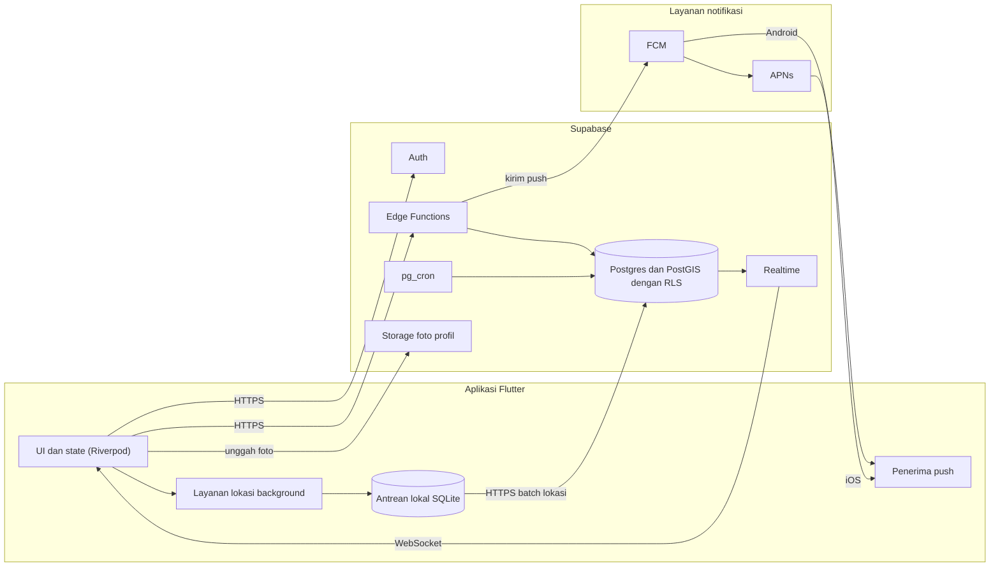
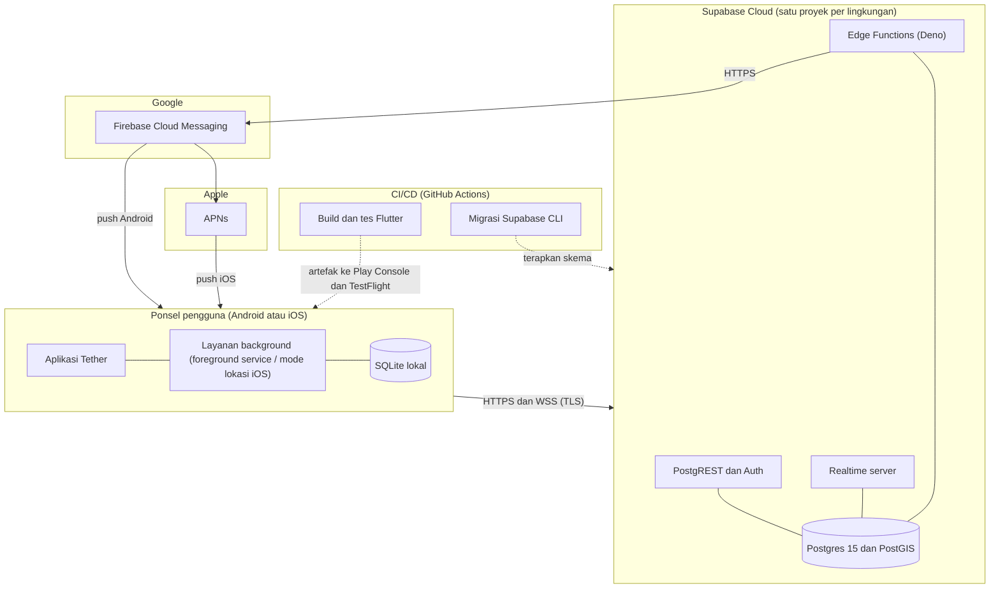

# 03. Arsitektur dan Keputusan Teknologi

Versi: Draf 1. Semua pilihan pustaka bersifat kandidat sampai spike (06) selesai. Versi paket belum diverifikasi.

## 1. Gambaran
```
 Flutter App (Android/iOS)
 ├─ UI + state (Riverpod)
 ├─ Layanan lokasi background (native bridge)
 ├─ Antrean lokal offline (SQLite/Drift)
 └─ FCM / APNs penerima push
        │ HTTPS / WebSocket
        ▼
 Supabase
 ├─ Auth (email, Google)
 ├─ Postgres + PostGIS (data, RLS)
 ├─ Realtime (posisi anggota Circle)
 ├─ Edge Functions (geofence, SOS, undangan, hapus akun)
 ├─ pg_cron (retensi data)
 └─ Storage (foto profil)
        │
        ▼
 FCM (push Android) dan APNs via FCM (iOS)
```

## 2. Alur utama

**Unggah lokasi**
1. Layanan background menangkap titik (lat, lng, akurasi, kecepatan, baterai, waktu).
2. Titik disimpan di antrean lokal, dikirim batch ke tabel `location_points` (atau RPC).
3. Trigger atau Edge Function memperbarui `member_status` (posisi terakhir) dan mengevaluasi geofence.
4. Realtime menyiarkan `member_status` ke anggota Circle yang sedang membuka aplikasi.

**Tiba atau pergi dari tempat**
1. Edge Function membandingkan posisi baru dengan `places` Circle (ST_DWithin).
2. Jika status berubah (di luar ke dalam), buat `event` dan kirim push ke anggota Circle lain.
3. Debounce: perlu 2 titik berurutan di dalam radius sebelum menyatakan "tiba".

**SOS**
1. Klien memanggil Edge Function `trigger_sos` dengan lokasi terbaru.
2. Fungsi membuat `alert` dan mengirim push prioritas tinggi ke semua anggota.

## 2a. Diagram komponen



## 2b. Diagram deployment



Catatan: versi Postgres, pemilihan GitHub Actions sebagai CI, dan struktur proyek per lingkungan adalah usulan dan belum diverifikasi. Diagram urutan dan state ada di [07-uml-diagrams.md](07-uml-diagrams.md).

## 3. ADR (Architecture Decision Records)

### ADR-001: Flutter untuk klien
- **Status:** diterima (keputusan pengguna).
- **Konsekuensi:** satu basis kode. Lokasi background tetap butuh konfigurasi dan mungkin kode native per platform (foreground service Android, mode background location iOS).

### ADR-002: Supabase untuk backend
- **Status:** diterima.
- **Alasan:** data relasional (Circle, anggota, tempat) cocok dengan Postgres. PostGIS untuk geofence. RLS untuk izin per Circle. Realtime bawaan. Bisa self-host bila perlu.
- **Risiko:** batas koneksi realtime dan biaya pada skala besar. Pantau.
- **Alternatif ditolak:** Firebase (NoSQL, biaya baca/tulis lokasi tinggi, query geospasial terbatas).

### ADR-003: State management, Riverpod
- **Status:** diusulkan. Alternatif: Bloc. Pilih satu dan tulis konvensi sebelum ngoding.

### ADR-004: Peta
- **Status:** terbuka. Kandidat: `flutter_map` dengan tile OSM atau penyedia tile berbayar murah, atau `google_maps_flutter`.
- **Pertimbangan:** biaya per muatan peta, kualitas data Indonesia, kebijakan penggunaan tile publik OSM (tidak untuk pemakaian berat tanpa penyedia sendiri). **[Belum diverifikasi]**
- **Keputusan (Sprint 0A, 2026-11-04): `flutter_map`.** Tag platform di pub.dev (diperiksa hari itu): `flutter_map` mendukung Android, iOS, Linux, web, Windows, macOS. `google_maps_flutter` hanya Android, iOS, web. Pengujian dilakukan di Linux, jadi hanya `flutter_map` yang berjalan di semua klien.
- **Belum diputuskan:** penyedia tile (biaya, kebijakan pemakaian OSM, kualitas data Indonesia). Diputuskan di Sprint 3.

### ADR-005: Pustaka lokasi background
- **Status:** terbuka, diputuskan lewat spike.
- **Kandidat:** `geolocator` ditambah foreground service, atau pustaka khusus pelacakan background. Beberapa pustaka komersial memerlukan lisensi untuk rilis Android **[Belum diverifikasi]**. Evaluasi: keandalan di Xiaomi/Oppo/Vivo/Samsung, dampak baterai, biaya lisensi, pemeliharaan.

### ADR-006: Evaluasi geofence di server
- **Status:** diusulkan untuk MVP.
- **Alasan:** satu sumber kebenaran, perilaku sama di Android dan iOS, jumlah tempat bisa lebih dari batas OS.
- **Kekurangan:** bergantung pada titik yang terkirim, latensi sedikit lebih tinggi.
- **Evolusi:** tambahkan geofence OS di klien untuk menghemat baterai bila diperlukan.

### ADR-007: Pelacakan adaptif
- **Status:** diusulkan.
- Mode diam: perubahan lokasi signifikan, jarang mengirim (misalnya tiap 15 menit sebagai detak).
- Mode bergerak: interval lebih rapat (misalnya 15 sampai 30 detik), ambang jarak.
- Baterai rendah: mode hemat otomatis.
- Angka di atas awal dan harus dikalibrasi di spike.

### ADR-008: Retensi lokasi
- 48 jam untuk `location_points`, hapus dengan `pg_cron`. `member_status` hanya menyimpan posisi terakhir.

## 4. Struktur proyek Flutter (usulan)
```
lib/
├─ app/            # routing, tema, bootstrap
├─ core/           # util, error, konfigurasi, jaringan
├─ features/
│  ├─ auth/
│  ├─ circle/
│  ├─ map/
│  ├─ places/
│  ├─ sos/
│  ├─ settings/
│  └─ location_tracking/   # layanan background + antrean
└─ l10n/
```
Setiap fitur dibagi `data/`, `domain/`, `presentation/`.

## 5. Lingkungan
`dev` (lokal + proyek Supabase dev), `staging`, `prod`. Rahasia hanya di variabel lingkungan CI dan Edge Function, tidak di klien.

## 6. CI/CD
- Lint (`flutter analyze`), tes unit dan widget pada setiap PR.
- Build Android dan iOS terjadwal.
- Migrasi database dengan Supabase CLI, disimpan di repo.

## 7. Pertanyaan terbuka
- Peta: OSM atau Google? (ADR-004)
- Perlu login telepon? (01)
- Rencana self-host Supabase atau cloud terkelola?
