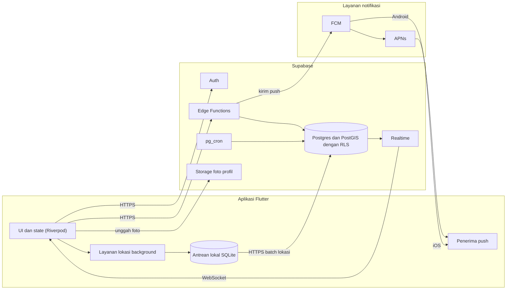
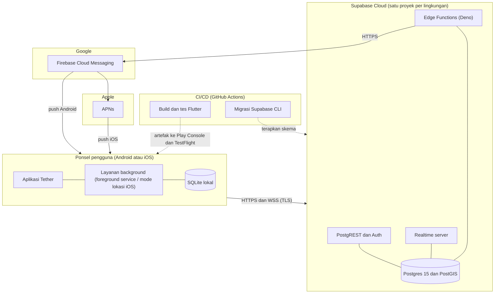

# 03. Arsitektur dan Keputusan Teknologi

Versi: Draf 2 (diselaraskan dengan migrasi `20261104120000` sampai `20261104130800` per 2026-11-05). Pilihan pustaka untuk lokasi background masih kandidat sampai Sprint 0B selesai. Versi paket belum diverifikasi.

Status verifikasi: bagian yang menyebut perilaku server (tabel, RPC, RLS, trigger) diverifikasi dengan membaca migrasi dan lulus 634 tes pgTAP di Supabase lokal. Perilaku di Android, ponsel, layanan background, baterai, dan FCM **belum terverifikasi** karena belum pernah dijalankan (lihat [sprints/sprint-1-5.md](sprints/sprint-1-5.md)).

## 1. Gambaran
```
 Flutter App (Android/iOS)
 ├─ UI + state (Riverpod)
 ├─ Layanan lokasi background (native bridge)
 ├─ Antrean lokal offline (SQLite/Drift)
 └─ FCM / APNs penerima push
        │ HTTPS / WebSocket
        ▼
 Supabase
 ├─ Auth (email, Google)
 ├─ Postgres + PostGIS (data, RLS)
 ├─ Realtime (posisi anggota Circle)
 ├─ Edge Functions (geofence, SOS, undangan, hapus akun)
 ├─ pg_cron (retensi data)
 └─ Storage (foto profil)
        │
        ▼
 FCM (push Android) dan APNs via FCM (iOS)
```

## 2. Alur utama (sesuai implementasi Sprint 1 sampai 5)

Rancangan awal memakai Edge Function. Implementasi memakai RPC dan trigger Postgres (ADR-009), jadi belum ada Edge Function sama sekali. Klien tidak punya hak tulis langsung ke tabel mana pun kecuali `profiles` (kolom `display_name`, `color`, `avatar_url`) dan `notification_settings` (tiga sakelar); semua perubahan lain lewat RPC `SECURITY DEFINER` dengan `search_path` terkunci dan pengguna dari `auth.uid()`.

**Unggah lokasi**
1. Pelacakan menangkap titik (lat, lng, akurasi, kecepatan, baterai, waktu) dan menyimpannya di antrean lokal SQLite (drift).
2. `LocationUploader` mengirim batch ke RPC `upload_points(p_points jsonb)` (maksimal 500 titik, `recorded_at` tidak boleh lebih dari 5 menit di masa depan, titik lebih tua dari 48 jam dilewati, kiriman ulang idempoten lewat `unique (user_id, recorded_at)`).
3. Bila pengguna punya keanggotaan tetapi SEMUA keanggotaannya dijeda atau `sharing_enabled = false`, RPC mengembalikan 0 tanpa menyimpan (jeda ditegakkan di server). Pengguna tanpa keanggotaan tetap diterima (onboarding).
4. Trigger `location_points_after_insert` memperbarui `member_status` (hanya bila titik lebih baru dari `last_seen_at`) dan mengevaluasi geofence.
5. Realtime menyiarkan `member_status` dan INSERT `events` ke klien yang membuka kanal dengan JWT pengguna. RLS dihormati untuk INSERT dan UPDATE.

**Tiba atau pergi dari tempat (geofence per Circle)**
1. Untuk setiap keanggotaan Circle yang aktif (berbagi menyala dan tidak dijeda), titik dibandingkan hanya dengan `places` milik Circle itu (`ST_DWithin`, tempat terdekat bila tumpang tindih). Titik dengan akurasi lebih buruk dari 100 m tidak dievaluasi.
2. Status disimpan di `member_place_state (user_id, circle_id)`. Debounce: perlu 2 titik berurutan dengan kandidat sama sebelum `arrive` atau `leave` dinyatakan.
3. Event `arrive` atau `leave` membawa `circle_id` Circle tersebut dan payload `place_name` dan `recorded_at`, tanpa koordinat.
4. Keanggotaan yang dijeda tidak dievaluasi dan tidak menghasilkan event, supaya jeda tidak bocor lewat arrive/leave.

**Notifikasi**
1. Setiap INSERT `events` dengan `circle_id` memicu `events_after_insert`, yang mengisi `push_outbox` satu baris per anggota Circle selain pelaku, menurut preferensi `notification_settings` (`sos` selalu).
2. Belum ada pengirim dari `push_outbox` ke FCM. Baris menumpuk dengan `sent_at` null.
3. Untuk sementara klien yang sedang terbuka menampilkan notifikasi lokal dari event Realtime (ADR-011). Ini tidak mencakup aplikasi yang ditutup atau ponsel terkunci.

**Check-in**
1. Klien memanggil RPC `checkin(p_circle_id, p_kind)` dengan `p_kind` `arrived` atau `safe`.
2. Event `checkin` dibuat dengan payload `{kind, display_name}`, tanpa koordinat. Batas laju 1 per 30 detik per pengguna per Circle (`TH006`). Berlaku walau pengguna sedang dijeda.

**SOS**
1. Tombol SOS ditahan 3 detik, lalu hitung mundur 5 detik yang bisa dibatalkan. Sebelum mengirim, klien mencatat SOS ke antrean berkas JSON lokal dengan `client_id` dan `triggered_at` (ADR-010).
2. Klien memanggil RPC `trigger_sos(p_lat, p_lng, p_accuracy_m, p_client_id, p_triggered_at)`. RPC membuat satu event `sos` di SETIAP Circle pengguna dan mengembalikan jumlah Circle yang diberi tahu. Pemanggilan ulang dengan `client_id` sama tidak membuat event baru dan tidak memakai jatah laju.
3. SOS tetap berlaku walau pengguna dijeda (ADR-012). Batas laju 3 pemicu per 10 menit (`TH007`), tanpa Circle `TH008`.
4. Koordinat SOS hanya terbaca anggota Circle selama 48 jam, lalu dibuang oleh `purge_old_events` (lihat 05 bagian 7).

**Hapus akun**
`delete_account()` menonaktifkan akun segera (tanda `deleted_at`, login diblokir, sesi dicabut, keluar dari semua Circle, titik lokasi, event, perangkat, dan status dihapus). `purge_deleted_accounts()` menghapus tuntas baris `auth.users` setelah 30 hari (ADR-014).

## 2a. Diagram komponen



## 2b. Diagram deployment



Catatan implementasi: diagram 2a dan 2b adalah rancangan target. Pada Sprint 1 sampai 5 belum ada Edge Function, Storage foto profil, FCM, atau APNs yang dibangun (ADR-009, ADR-011). Antrean lokal SQLite dipakai untuk titik lokasi; SOS memakai antrean berkas JSON terpisah (ADR-010).

Catatan: versi Postgres, pemilihan GitHub Actions sebagai CI, dan struktur proyek per lingkungan adalah usulan dan belum diverifikasi. Diagram urutan dan state ada di [07-uml-diagrams.md](07-uml-diagrams.md).

## 3. ADR (Architecture Decision Records)

### ADR-001: Flutter untuk klien
- **Status:** diterima (keputusan pengguna).
- **Konsekuensi:** satu basis kode. Lokasi background tetap butuh konfigurasi dan mungkin kode native per platform (foreground service Android, mode background location iOS).

### ADR-002: Supabase untuk backend
- **Status:** diterima.
- **Alasan:** data relasional (Circle, anggota, tempat) cocok dengan Postgres. PostGIS untuk geofence. RLS untuk izin per Circle. Realtime bawaan. Bisa self-host bila perlu.
- **Risiko:** batas koneksi realtime dan biaya pada skala besar. Pantau.
- **Alternatif ditolak:** Firebase (NoSQL, biaya baca/tulis lokasi tinggi, query geospasial terbatas).

### ADR-003: State management, Riverpod
- **Status:** diterima, dipakai sejak Sprint 1 (`flutter_riverpod`, ditambah `go_router` untuk routing). Alternatif yang ditolak: Bloc.

### ADR-004: Peta
- **Status:** terbuka. Kandidat: `flutter_map` dengan tile OSM atau penyedia tile berbayar murah, atau `google_maps_flutter`.
- **Pertimbangan:** biaya per muatan peta, kualitas data Indonesia, kebijakan penggunaan tile publik OSM (tidak untuk pemakaian berat tanpa penyedia sendiri). **[Belum diverifikasi]**
- **Keputusan (Sprint 0A, 2026-11-04): `flutter_map`.** Tag platform di pub.dev (diperiksa hari itu): `flutter_map` mendukung Android, iOS, Linux, web, Windows, macOS. `google_maps_flutter` hanya Android, iOS, web. Pengujian dilakukan di Linux, jadi hanya `flutter_map` yang berjalan di semua klien.
- **Belum diputuskan:** penyedia tile (biaya, kebijakan pemakaian OSM, kualitas data Indonesia). Diputuskan di Sprint 3.

### ADR-005: Pustaka lokasi background
- **Status:** terbuka, diputuskan lewat spike.
- **Kandidat:** `geolocator` ditambah foreground service, atau pustaka khusus pelacakan background. Beberapa pustaka komersial memerlukan lisensi untuk rilis Android **[Belum diverifikasi]**. Evaluasi: keandalan di Xiaomi/Oppo/Vivo/Samsung, dampak baterai, biaya lisensi, pemeliharaan.

### ADR-006: Evaluasi geofence di server
- **Status:** diterima dan diimplementasikan (Sprint 0A, dikembangkan di Sprint 4 menjadi per Circle, lihat ADR-015). Diimplementasikan sebagai trigger Postgres, bukan Edge Function (ADR-009).
- **Alasan:** satu sumber kebenaran, perilaku sama di Android dan iOS, jumlah tempat bisa lebih dari batas OS.
- **Kekurangan:** bergantung pada titik yang terkirim, latensi sedikit lebih tinggi.
- **Evolusi:** tambahkan geofence OS di klien untuk menghemat baterai bila diperlukan.

### ADR-007: Pelacakan adaptif
- **Status:** diusulkan.
- Mode diam: perubahan lokasi signifikan, jarang mengirim (misalnya tiap 15 menit sebagai detak).
- Mode bergerak: interval lebih rapat (misalnya 15 sampai 30 detik), ambang jarak.
- Baterai rendah: mode hemat otomatis.
- Angka di atas awal dan harus dikalibrasi di spike.

### ADR-008: Retensi lokasi
- **Status:** diterima dan diimplementasikan (migrasi `130600`, `130700`).
- 48 jam untuk `location_points` (`purge_old_location_points`, tiap jam). `member_status` hanya menyimpan posisi terakhir.
- `events` dihapus setelah 90 hari (`purge_old_events`, harian 03:10 UTC). Koordinat SOS (`lat`, `lng`, `accuracy_m`) dibuang dari payload setelah 48 jam oleh fungsi yang sama.
- Akun yang ditandai hapus dibersihkan tuntas setelah 30 hari (`purge_deleted_accounts`, harian 03:00 UTC).
- Penjadwalan memakai `pg_cron` secara bersyarat (ADR-013). Partisi harian `location_points` yang dulu direncanakan **belum dikerjakan**: tabel masih biasa, dengan indeks `recorded_at` untuk purge.

### ADR-009: Logika server sebagai RPC dan trigger Postgres, bukan Edge Function
- **Status:** diterima (Sprint 0A sampai 5). Menggantikan rancangan awal yang memakai Edge Function untuk geofence, SOS, undangan, dan hapus akun.
- **Keputusan:** semua tulis lewat fungsi `SECURITY DEFINER` dengan `search_path = ''`, pengguna dari `auth.uid()`. Tabel `circles`, `circle_members`, `invites`, `join_attempts`, `places`, `location_points`, `member_status`, `member_place_state`, `events`, `devices`, `push_outbox` tidak punya hak INSERT, UPDATE, atau DELETE untuk klien. `invites`, `join_attempts`, `member_place_state`, `devices`, dan `push_outbox` bahkan tanpa hak SELECT. Dasar GRANT dicabut dulu (bawaan Supabase memberi ALL ke `anon` dan `authenticated`), lalu hanya yang perlu diberikan.
- **Alasan:** satu bahasa dan satu tempat transaksi, geofence dan outbox atomik dengan insert titik atau event, tes lewat pgTAP tanpa jaringan, tidak ada Edge Function yang perlu dideploy dan dijaga.
- **Konsekuensi:** pengirim push ke FCM tetap perlu proses di luar database (Edge Function atau layanan lain) yang membaca `push_outbox`. Itu belum ada (ADR-011).
- **Daftar kode galat khusus aplikasi** (SQLSTATE; lainnya memakai standar `28000` tidak login, `22023` argumen tidak valid, `42501` bukan anggota atau bukan admin, `P0002` target tidak ditemukan):

| Kode | Arti | RPC |
|------|------|-----|
| `TH001` | `recorded_at` lebih dari 5 menit di masa depan (jam perangkat). Klien menahan titik, bukan membuang | `upload_points` |
| `TH002` | Terlalu banyak percobaan gabung (10 gagal dalam 15 menit) | `preview_invite`, `join_circle` (lewat `check_join_rate`) |
| `TH003` | Circle penuh (10 anggota) | `join_circle` |
| `TH004` | Batas 5 keanggotaan Circle per pengguna | `create_circle` |
| `TH005` | Batas 5 tempat per Circle | `create_place` |
| `TH006` | Check-in lebih dari 1 per 30 detik per Circle | `checkin` |
| `TH007` | Lebih dari 3 pemicu SOS per 10 menit | `trigger_sos` |
| `TH008` | SOS tanpa keanggotaan Circle | `trigger_sos` |

### ADR-010: Antrean SOS berkas JSON dengan `client_id`
- **Status:** diterima, hanya terverifikasi di Linux dan lewat tes.
- **Keputusan:** SOS dicatat lebih dulu ke berkas `tether_sos_queue.json` di direktori dokumen aplikasi (`FileSosQueueStore`), dengan `client_id` (UUID v4) dan `triggered_at` dari saat SOS dipicu, baru dikirim ke `trigger_sos`. Gagal sementara (jaringan, sesi, galat tak dikenal) membiarkan SOS di antrean dan dicoba ulang dengan jeda 2, 4, 8, 16, 32 detik lalu tetap 60 detik. Gagal permanen (batas laju, tanpa Circle, bukan anggota, argumen ditolak) membuang SOS. Antrean dikirim ulang (`flush`) saat layanan SOS dibuat (dibaca saat tab Peta tampil) dan setiap kali pengguna masuk.
- **Alasan:** SOS harus tetap terkirim setelah koneksi kembali. Berkas JSON sederhana dan terpisah dari antrean titik lokasi (SQLite), sehingga kegagalan satu antrean tidak memengaruhi yang lain. `client_id` membuat pengulangan aman: server tidak membuat event atau push ganda dan tidak memakai jatah laju.
- **Batas usia:** klien membuang SOS yang lebih tua dari 1 hari, sama dengan penjepit `triggered_at` di server ke rentang [sekarang dikurangi 1 hari, sekarang].
- **Kekurangan:** SOS lama yang akhirnya terkirim tampil dengan `triggered_at` asli tetapi `created_at` waktu server. Jendela baca 48 jam dihitung dari `created_at`. Koordinat yang dikirim adalah koordinat saat dipicu, bukan posisi terkini.
- **Belum terverifikasi:** perilaku saat aplikasi dimatikan paksa oleh OS (Android), saat ponsel hemat daya, dan pada jaringan nyata yang putus sebagian. Di Linux hanya diuji dengan mematikan Supabase lokal.

### ADR-011: Notifikasi lokal dahulu, FCM menyusul
- **Status:** diterima sebagai langkah sementara. FCM **belum dibangun**.
- **Keputusan:** `flutter_local_notifications` menampilkan notifikasi dari event Realtime selagi aplikasi terbuka dan tersambung. Server sudah menyiapkan `devices` (RPC `register_device`, `unregister_device`, maksimal 10 perangkat per pengguna, token milik pengguna lain dihapus saat perangkat berganti akun), `notification_settings`, dan `push_outbox` (tanpa isi payload, hanya `event_id` dan penerima).
- **Alasan:** proyek Firebase milik pemilik belum ada, dan FCM tidak diuji di Linux. Notifikasi lokal bisa diuji sekarang dan menjaga alur UI (lencana, ketuk notifikasi) siap.
- **Konsekuensi:** notifikasi TIDAK sampai bila aplikasi ditutup atau dimatikan OS. Itu bukan memenuhi PRD F10. `push_outbox` terus menumpuk (`sent_at` null) sampai ada pengirim, dan perlu kebijakan pembersihan yang saat ini hanya cascade dari `events` (90 hari).
- **Belum terverifikasi:** seluruh perilaku notifikasi di Android (kanal, izin `POST_NOTIFICATIONS`, penahanan oleh Xiaomi/Redmi), FCM, dan prioritas tinggi untuk SOS.

### ADR-012: Check-in tanpa koordinat, SOS satu-satunya event berkoordinat, SOS tanpa pembatasan jeda
- **Status:** diterima. Perlu tinjauan hukum bersama kebijakan privasi (05).
- **Check-in:** payload hanya `{kind, display_name}`. Berlaku walau pengguna sedang dijeda karena tindakan sengaja tanpa lokasi.
- **SOS:** satu-satunya event yang membawa `lat`, `lng`, `accuracy_m`, dan `triggered_at` (dan `client_id`) di payload. Event lain tidak boleh memuat koordinat. SOS dikirim ke SEMUA Circle pengguna, juga yang sedang dijeda atau `sharing_enabled = false`, karena keselamatan mengalahkan jeda dan pemicunya adalah tindakan sengaja. Pesan galat tidak memuat koordinat.
- **Pembatasan yang tetap berlaku:** batas laju 3 pemicu per 10 menit per pengguna (`TH007`) dan harus punya minimal satu Circle (`TH008`). Pemicu dihitung per `created_at` yang berbeda karena satu pemicu menghasilkan satu event per Circle.
- **Jendela baca 48 jam:** kebijakan `events_select_circle` membuat event `sos` hanya terbaca anggota Circle selama 48 jam sejak `created_at`; sesudahnya hanya pelakunya. Koordinat di payload dibuang oleh `purge_old_events` (harian), jadi penyimpanan fisik bisa sampai sekitar 72 jam; batasnya ditegakkan RLS.
- **Dampak ke jeda:** menjeda berbagi tidak mencegah SOS. UI wajib menjelaskan ini (disclaimer "SOS bukan pengganti layanan darurat" sudah ada di sheet Keselamatan).

### ADR-013: pg_cron bersyarat
- **Status:** diterima dengan risiko diketahui; alarm keras ditambahkan pada migrasi `130900`.
- **Keputusan:** migrasi `130600` menjadwalkan tiga job hanya bila ekstensi `pg_cron` tersedia: `tether_purge_location_points` (tiap jam, menit 0), `tether_purge_deleted_accounts` (harian 03:00 UTC, dinaikkan menjadi tiap jam menit 17 oleh migrasi `130900` supaya penghapusan tuntas tidak bisa terlambat satu hari melewati hari ke-30), `tether_purge_events` (03:10 UTC). Bila ekstensi tidak tersedia, migrasi hanya mengeluarkan NOTICE dan tetap berhasil.
- **Alarm (migrasi `130900`):** bila ekstensi `pg_cron` tersedia tetapi ada job yang gagal terdaftar, migrasi sekarang GAGAL dengan pesan eksplisit, bukan NOTICE senyap. Kecepatan deploy ke proyek cloud yang menolak ekstensi tetap aman (NOTICE), tetapi deploy yang gagal menjadwalkan job melaporkan kegagalan.
- **Risiko tersisa:** kegagalan eksekusi harian (bukan kegagalan penjadwalan) tetap tidak terlihat oleh migrasi. Setelah deploy, cek `select jobname, schedule from cron.job` dan `cron.job_run_details`. Tes pgTAP `15_realtime_retention` melewati pemeriksaan job bila ekstensi tidak ada.
- **Belum terverifikasi:** ketersediaan `pg_cron` di proyek Supabase cloud yang akan dipakai, dan apakah jobnya benar-benar berjalan pada jadwal.

### ADR-014: Hapus akun dua tahap
- **Status:** diterima; penjaga tulis untuk token lama ditambahkan pada migrasi `130900`.
- **Keputusan:** `delete_account()` segera menandai `profiles.deleted_at`, menghapus `location_points`, `events`, `devices`, `member_status`, `member_place_state`, dan `push_outbox` milik pengguna, keluar dari semua Circle lewat `leave_circle` (aturan promosi admin dan penghapusan Circle kosong sama), memblokir login (`auth.users.banned_until`) dan mencabut sesi. `purge_deleted_accounts()` (tiap jam menit 17, lihat ADR-013) menghapus baris `auth.users` yang `deleted_at`-nya lebih tua dari 30 hari sehingga seluruh data turunan ikut terhapus lewat cascade, dan menghapus Circle yatim.
- **Keterbatasan diketahui:** access token (JWT) yang sudah terbit tetap sah sampai kedaluwarsa (`jwt_expiry` 3600 detik di config lokal). Semua RPC tulis kini memanggil `assert_account_active()` (migrasi `130900`, lihat ADR-017), jadi token lama tidak bisa menulis apa pun; sisa risikonya hanya baca sampai token kedaluwarsa.

### ADR-015: Geofence per Circle
- **Status:** diterima (Sprint 4). Menggantikan model spike dengan satu `current_place_id` per pengguna di `member_status`.
- **Keputusan:** status geofence di `member_place_state (user_id, circle_id)`. Titik dievaluasi per keanggotaan aktif terhadap `places` Circle itu saja, dengan debounce 2 titik dan abaikan akurasi di atas 100 m. Keanggotaan yang dijeda atau `sharing_enabled = false` tidak dievaluasi dan tidak menghasilkan event. Keluar atau dikeluarkan dari Circle menghapus status Circle itu (trigger `circle_members_after_delete`).
- **Tempat:** setiap anggota boleh membuat tempat (maksimal 5 per Circle, radius 100 sampai 5000 m). Mengubah nama dan radius atau menghapus hanya untuk pembuat atau admin. Posisi tempat tidak bisa diubah (hapus lalu buat ulang). Menghapus tempat mengosongkan status yang menunjuknya; event lama tetap ada dengan nama tempat di payload.
- **Sisa:** kolom geofence di `member_status` tidak dipakai lagi (selalu null/0/false) dan ditandai di komentar kolom.

### ADR-016: `circle_members` dikeluarkan dari publikasi Realtime
- **Status:** diterima (migrasi `130000`).
- **Alasan:** event DELETE pada Postgres Changes tidak difilter RLS dan membawa primary key ke semua pelanggan kanal. PK `circle_members` adalah `(circle_id, user_id)`, jadi siapa keluar dari Circle mana bocor ke pengguna lain.
- **Keputusan:** hanya `member_status` dan `events` yang dipublikasikan. Klien mendengarkan INSERT `events` bertipe `member_joined`, `member_left`, `member_removed` (diterbitkan RPC) lalu mengambil ulang daftar anggota. INSERT dan UPDATE tetap diperiksa RLS per pelanggan.
- **Sisa kebocoran yang diketahui (diterima):** DELETE `member_status` (PK `user_id`), DELETE `events` (PK `id`), dan DELETE `places` (PK UUID acak) masih sampai tanpa filter Circle. Isinya hanya kunci utama (UUID tempat acak, tanpa nama maupun Circle), tetapi tetap menandakan ada baris yang dihapus. Risikonya diterima dan didokumentasikan: kurasi penuh tidak mungkin karena SELECT/UPDATE saja yang diperiksa per pelanggan, dan dukungan filter per event RLC pada DELETE serta kanal privat belum tersedia di Supabase.

### ADR-017: Penjaga akun terhapus di RPC tulis, event `sharing_changed`, dan dedup push (migrasi `130900`)
- **Status:** diterima (gelombang 4 perbaikan audit).
- **Penjaga token lama:** fungsi `assert_account_active()` (SECURITY DEFINER, tanpa EXECUTE untuk klien) menolak pemanggil dengan `profiles.deleted_at` terisi (`28000`, dianggap "tidak masuk" klien). Dipanggil di awal semua RPC tulis: `upload_points`, `create_circle`, `create_invite`, `preview_invite`, `join_circle`, `remove_member`, `pause_sharing`, `resume_sharing`, `set_sharing_enabled`, `create_place`/`update_place`/`delete_place`, `checkin`, `trigger_sos`, `register_device`, `unregister_device`, `delete_my_location_history`. Tanpa penjaga: `delete_account()` (harus tetap idempoten) dan `leave_circle()` (dipakai `delete_account()` sesudah `deleted_at` diisi).
- **Event `sharing_changed`:** karena `circle_members` tidak dipublikasikan Realtime (ADR-016), anggota lain tidak tahu `sharing_enabled` berubah. `set_sharing_enabled` kini menerbitkan event `sharing_changed` (payload `{enabled}`) hanya bila nilai benar-benar berubah; constraint `events_type_check` diperluas, outbox memakai preferensi `member_changes`, dan klien memilikinya di tab Aktivitas. UI: tab Circle punya kartu sakelar "Berbagi lokasi" (milik sendiri) yang memanggil RPC ini; tab Circle dan Peta memuat ulang saat event diterima (`memberEventTypes` dan `_refreshEventTypes` memuat `sharing_changed`).
- **Dedup push SOS:** satu pemicu SOS membuat satu event per Circle, dan penerima yang berada di dua Circle pengirim mendapat dua baris outbox (dua push). Trigger `events_after_insert` sekarang tidak membuat baris outbox kedua untuk `(penerima, client_id)` yang sudah ada; klien juga mendedup notifikasi lokal berdasarkan `client_id`.

### ADR-018: `places` sebagai sumber Realtime (migrasi `131000`)
- **Status:** diterima.
- **Alasan:** perubahan tempat oleh anggota lain hanya tampak setelah muat ulang halaman; klien perlu daftar tempat terkini untuk peta dan geofence.
- **Keputusan:** tabel `places` ditambahkan ke publikasi `supabase_realtime`. Klien peta memuat ulang daftar tempat saat INSERT, UPDATE, atau DELETE `places` di kanal Circle. Inventaris kembali ke kebijakan SELECT per pelanggan (hanya anggota Circle).
- **Sisa diketahui:** DELETE membawa UUID acak tempat ke semua pelanggan kanal, sama seperti di ADR-016; risikonya diterima.

## 4. Struktur proyek Flutter (sesuai kode saat ini)
```
lib/
├─ app/            # routing, tema, kerangka tab
├─ core/           # util, error, konfigurasi, Circle terpilih
├─ features/
│  ├─ auth/
│  ├─ circle/
│  ├─ map/
│  ├─ places/
│  ├─ activity/            # tab Aktivitas, lencana, notifikasi lokal
│  ├─ safety/              # check-in dan SOS, antrean SOS
│  ├─ history/             # riwayat lokasi 48 jam
│  ├─ profile/             # profil, pengaturan, hapus akun
│  ├─ location_tracking/   # sumber lokasi, antrean titik, pengunggah
│  └─ tracking/            # pengendali pelacakan, onboarding izin, panel simulasi
└─ l10n/
```
Setiap fitur dibagi `data/`, `domain/`, `presentation/` (sebagian memakai berkas rute di akar fitur). Rancangan awal punya `features/sos/` dan `features/settings/`; keduanya tidak dibuat (SOS ada di `safety/`, pengaturan di `profile/`).

## 5. Lingkungan
`dev` (lokal + proyek Supabase dev), `staging`, `prod`. Rahasia hanya di variabel lingkungan CI dan Edge Function, tidak di klien.

## 6. CI/CD
- Lint (`flutter analyze`), tes unit dan widget pada setiap PR. Saat ini `.github/workflows/ci.yml` menjalankan `build_runner`, `flutter analyze`, dan `flutter test` (belum ada tes pgTAP, tes integrasi, maupun build di CI).
- Build Android dan iOS terjadwal.
- Migrasi database dengan Supabase CLI, disimpan di repo.

## 7. Pertanyaan terbuka
- Peta: OSM atau Google? (ADR-004)
- Perlu login telepon? (01)
- Pengirim FCM dari `push_outbox`: Edge Function atau layanan lain? Menunggu proyek Firebase (ADR-011).
- Penyedia tile peta final (ADR-004).
- Rencana self-host Supabase atau cloud terkelola?
