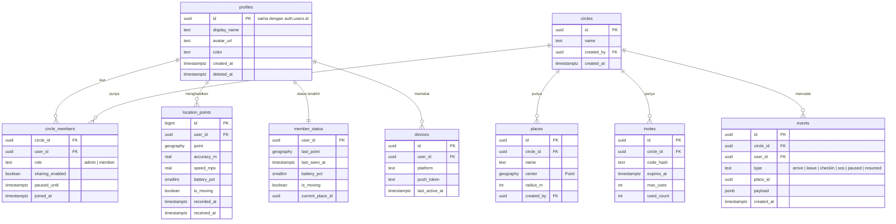

# 04. Model Data

Versi: Draf 1. Nama dan tipe adalah usulan, finalisasi saat menulis migrasi.

## ERD

## Catatan desain
- `location_points` dipartisi per hari agar penghapusan retensi murah.
- Indeks: `(user_id, recorded_at desc)`, indeks GiST pada `places.center`.
- Kode undangan disimpan sebagai hash, bukan teks asli.
- `circle_members.paused_until` dan `sharing_enabled` ditegakkan juga di server: titik lokasi dari anggota yang sedang dijeda ditolak atau tidak disiarkan.
- Hapus akun: tandai `deleted_at`, hapus data turunan lewat job dalam 30 hari.

## Aturan RLS (usulan)
| Tabel | Baca | Tulis |
|-------|------|-------|
| profiles | Diri sendiri dan anggota Circle yang sama | Hanya diri sendiri |
| circles | Anggotanya | Pembuat (insert), admin (update, delete) |
| circle_members | Anggota Circle yang sama | Admin (kelola), diri sendiri (jeda, keluar) |
| places | Anggota Circle | Admin, atau anggota bila diizinkan (keputusan terbuka) |
| location_points | Pemilik; anggota Circle hanya 48 jam dan hanya bila `sharing_enabled` dan tidak dijeda | Hanya pemilik, lewat RPC tervalidasi |
| member_status | Anggota Circle yang sama selama berbagi aktif | Hanya lewat fungsi server |
| events | Anggota Circle | Hanya lewat fungsi server |
| devices | Pemilik | Pemilik |

## Pengujian RLS
Setiap kebijakan wajib punya tes: pengguna di luar Circle tidak bisa membaca, anggota yang dijeda tidak bocor, admin tidak bisa membaca lokasi anggota yang dijeda.

## Pertanyaan terbuka
- Apakah satu pengguna boleh ikut lebih dari satu Circle dengan pengaturan berbagi terpisah per Circle? (usulan: ya, `sharing_enabled` per keanggotaan)
- Siapa yang boleh membuat tempat?
