# 04. Model Data

Versi: Draf 2, diselaraskan dengan migrasi `20261104030647` (spike) dan `20261104120000` sampai `20261104130800` per 2026-11-05. Sumber kebenaran adalah folder `supabase/migrations`; dokumen ini ringkasan. Bagian "Belum terverifikasi" di akhir mencatat yang tidak bisa dipastikan dari migrasi.

## ERD

```mermaid
erDiagram
    profiles ||--o{ circle_members : "ikut"
    circles  ||--o{ circle_members : "punya"
    circles  ||--o{ places : "punya"
    circles  ||--o{ invites : "punya"
    circles  ||--o{ events : "mencatat"
    circles  ||--o{ member_place_state : "status geofence"
    profiles ||--o{ location_points : "menghasilkan"
    profiles ||--|| member_status : "status terakhir"
    profiles ||--|| notification_settings : "preferensi"
    profiles ||--o{ devices : "memakai"
    profiles ||--o{ push_outbox : "penerima"
    events   ||--o{ push_outbox : "memicu"

    profiles {
      uuid id PK "sama dengan auth.users.id"
      text display_name "1 sampai 40 karakter"
      text color "#RRGGBB, bawaan #0F766E"
      text avatar_url "maks 2048 karakter"
      timestamptz created_at
      timestamptz deleted_at "tanda hapus akun"
    }
    circles {
      uuid id PK
      text name "1 sampai 40 karakter"
      uuid created_by FK "set null bila profil hilang"
      timestamptz created_at
    }
    circle_members {
      uuid circle_id PK
      uuid user_id PK
      text role "admin | member"
      boolean sharing_enabled
      timestamptz paused_until "null | waktu | infinity"
      timestamptz joined_at
    }
    invites {
      uuid id PK
      uuid circle_id FK
      text code_hash "sha256 hex, unik"
      timestamptz expires_at "48 jam"
      int max_uses "bawaan 10"
      int used_count
      uuid created_by FK
      timestamptz revoked_at
      timestamptz created_at
    }
    join_attempts {
      uuid user_id FK
      timestamptz attempted_at
      boolean succeeded
    }
    places {
      uuid id PK
      uuid circle_id FK "wajib"
      text name "1 sampai 40 karakter"
      geography center "Point 4326"
      int radius_m "100 sampai 5000"
      uuid created_by FK
      timestamptz created_at
    }
    location_points {
      bigint id PK
      uuid user_id FK
      geography point "Point 4326"
      real accuracy_m
      real speed_mps
      smallint battery_pct "0 sampai 100"
      boolean is_moving
      timestamptz recorded_at "unik bersama user_id"
      timestamptz received_at
    }
    member_status {
      uuid user_id PK
      geography last_point
      timestamptz last_seen_at
      smallint battery_pct
      boolean is_moving
    }
    member_place_state {
      uuid user_id PK
      uuid circle_id PK
      uuid current_place_id FK
      uuid pending_place_id "tanpa FK"
      smallint pending_count
      boolean pending_is_outside
    }
    events {
      uuid id PK
      uuid user_id FK "pelaku"
      uuid circle_id FK
      text type "9 tipe, lihat tabel"
      uuid place_id FK
      jsonb payload
      timestamptz created_at
    }
    notification_settings {
      uuid user_id PK
      boolean arrive_leave
      boolean checkin
      boolean member_changes
    }
    devices {
      uuid id PK
      uuid user_id FK
      text platform "android | ios | linux | web"
      text push_token "unik per pengguna"
      timestamptz last_active_at
    }
    push_outbox {
      bigint id PK
      uuid event_id FK
      uuid recipient_id FK
      text kind
      timestamptz created_at
      timestamptz sent_at "null = belum terkirim"
      int attempts
    }
```

Perubahan dari rancangan awal: ditambah `join_attempts`, `member_place_state`, `notification_settings`, `push_outbox`; `invites` punya `revoked_at`, `created_by`, `created_at`; `places` dan `profiles` punya kolom tambahan; `member_status` tidak lagi memuat status geofence (kolom `current_place_id`, `pending_*` masih ada di tabel tetapi tidak dipakai dan selalu null/0/false, ditandai di komentar kolom).

## Tipe event
Kolom `events.type` dibatasi oleh `events_type_check`. `events.user_id` adalah pelaku, kecuali `member_removed` (anggota yang dikeluarkan, bukan admin).

| Tipe | Dibuat oleh | Payload | Koordinat |
|------|-------------|---------|-----------|
| `arrive`, `leave` | trigger `location_points_after_insert` | `place_name`, `recorded_at` (kolom `place_id` terisi) | Tidak |
| `checkin` | `checkin` | `kind` (`arrived` atau `safe`), `display_name` | Tidak |
| `sos` | `trigger_sos` | `display_name`, `lat`, `lng`, `accuracy_m`, `triggered_at`, `client_id` (bila diberikan) | **Ya, satu-satunya** |
| `paused` | `pause_sharing` | `minutes` (null = sampai dinyalakan lagi) | Tidak |
| `resumed` | `resume_sharing` (hanya bila memang sedang dijeda) | kosong | Tidak |
| `member_joined`, `member_left`, `member_removed` | `join_circle`, `leave_circle`, `remove_member` | `display_name` | Tidak |
| `sharing_changed` | `set_sharing_enabled` (hanya bila nilai berubah) | `enabled` | Tidak |

Event dengan `circle_id` null (sisa geofence spike) hanya terlihat oleh pemilik dan tidak memicu outbox.

## Catatan desain
- `location_points` BELUM dipartisi per hari (rencana awal ditunda). Retensi lewat `purge_old_location_points()` dengan indeks `recorded_at`. Indeks menurun `(user_id, recorded_at desc)` dihapus karena `unique (user_id, recorded_at)` sudah melayani kedua arah. Keputusan partisi ditinjau lagi bila volume menuntut.
- Indeks lain: GiST pada `places.center`, `places (circle_id)`, `circle_members (user_id)`, `invites (circle_id)`, `join_attempts (user_id, attempted_at desc)`, `events (circle_id, created_at desc)`, `events (created_at)`, `events (user_id, created_at desc)`, `member_place_state (circle_id)`, `push_outbox (id) where sent_at is null`, `push_outbox (event_id)`, `push_outbox (recipient_id)`.
- Kode undangan: 6 karakter dari 31 simbol tanpa `0 O 1 I L`, dibuat dari `gen_random_bytes` tanpa bias modulo, disimpan sebagai hash sha256 dari kode huruf besar. Kode asli hanya dikembalikan sekali oleh `create_invite`. Membuat undangan baru mencabut yang aktif. Berlaku 48 jam, maksimal 10 pemakaian.
- Batas yang diasumsikan di migrasi (ditandai ASUMSI di kode): 5 keanggotaan Circle per pengguna, 10 anggota per Circle, 10 perangkat per pengguna, panjang `avatar_url` 2048. Batas 5 tempat per Circle dan radius minimal 100 m berasal dari PRD F7.
- `circle_members.paused_until`: null berarti tidak dijeda, `infinity` berarti dijeda sampai dinyalakan lagi, nilai lampau dianggap tidak dijeda tanpa perlu baris diubah. Jeda dan `sharing_enabled` bersifat per keanggotaan (per Circle).
- Jeda dan `sharing_enabled` ditegakkan di server pada tiga tempat: kebijakan baca (`shares_active_circle`), `upload_points` (semua keanggotaan dijeda berarti titik tidak disimpan), dan geofence (keanggotaan yang dijeda tidak dievaluasi).
- `circle_members.user_id` mengacu ke `profiles` (bukan `auth.users`) agar PostgREST bisa meng-embed profil anggota.
- Hapus akun: lihat bagian "Hapus akun dan retensi".

## RPC dan fungsi
Semua RPC `SECURITY DEFINER`, `search_path` terkunci, `EXECUTE` dicabut dari `public` dan `anon`, diberikan ke `authenticated`. Pengguna selalu dari `auth.uid()`; tidak login memberi `28000`. Pesan galat tidak memuat koordinat.

| RPC | Hasil | Aturan utama | Kode galat |
|-----|-------|--------------|------------|
| `upload_points(p_points jsonb)` | jumlah baris masuk | maks 500 titik; titik > 48 jam dilewati; duplikat dilewati; semua keanggotaan dijeda berarti 0 | `22023`, `TH001` |
| `create_circle(p_name text)` | uuid | pembuat jadi admin; maks 5 keanggotaan | `22023`, `TH004` |
| `create_invite(p_circle_id uuid)` | tabel `(code, expires_at)` | hanya admin; mencabut undangan lama | `42501` |
| `preview_invite(p_code text)` | tabel `(circle_name, member_count)`, kosong bila tidak valid | tidak membedakan sebab; dihitung pada batas percobaan | `TH002` |
| `join_circle(p_code text)` | uuid atau NULL | NULL bila kode tidak valid, kedaluwarsa, dicabut, atau habis; sudah anggota berarti uuid tanpa efek ganda; maks 10 anggota; event `member_joined` | `TH002`, `TH003` |
| `leave_circle(p_circle_id uuid)` | void | anggota terakhir berarti Circle dihapus; admin terakhir berarti anggota tertua dipromosikan; event `member_left` | `42501` |
| `remove_member(p_circle_id uuid, p_user_id uuid)` | void | hanya admin; tidak boleh diri sendiri; event `member_removed` | `42501`, `22023`, `P0002` |
| `pause_sharing(p_circle_id uuid, p_minutes int default null)` | void | null berarti `infinity`; event `paused` | `22023`, `42501` |
| `resume_sharing(p_circle_id uuid)` | void | event `resumed` hanya bila sedang dijeda | `42501` |
| `set_sharing_enabled(p_circle_id uuid, p_enabled boolean)` | void | sakelar jangka panjang per Circle; menerbitkan event `sharing_changed` (payload `enabled`) hanya bila nilai berubah; dipanggil UI dari sakelar "Berbagi lokasi" di tab Circle | `22023`, `42501` |
| `create_place(p_circle_id, p_name, p_lat, p_lng, p_radius_m)` | uuid | semua anggota; maks 5 per Circle; radius 100 sampai 5000 | `22023`, `42501`, `TH005` |
| `update_place(p_place_id uuid, p_name text, p_radius_m int)` | void | pembuat atau admin; posisi tidak bisa diubah | `22023`, `P0002`, `42501` |
| `delete_place(p_place_id uuid)` | void | pembuat atau admin | `P0002`, `42501` |
| `checkin(p_circle_id uuid, p_kind text)` | uuid event | `arrived` atau `safe`; 1 per 30 detik per Circle; tanpa koordinat | `22023`, `42501`, `TH006` |
| `trigger_sos(p_lat, p_lng, p_accuracy_m real default null, p_client_id uuid default null, p_triggered_at timestamptz default null)` | jumlah Circle yang diberi tahu | event di semua Circle pengguna; 3 per 10 menit; `client_id` sama berarti idempoten; `triggered_at` dijepit ke [sekarang dikurangi 1 hari, sekarang] | `22023`, `TH007`, `TH008` |
| `register_device(p_platform text, p_push_token text)` | uuid | upsert per `(user_id, push_token)`; token milik pengguna lain dihapus; maks 10 perangkat | `22023` |
| `unregister_device(p_push_token text)` | void | token tak dikenal: tanpa galat | tidak ada |
| `delete_my_location_history()` | jumlah titik dihapus | menghapus semua `location_points` milik pemanggil; TIDAK menghapus `member_status` maupun `events` | tidak ada |
| `delete_account()` | void | lihat bagian di bawah | `P0002` |

Fungsi untuk RLS (boleh dipanggil `authenticated`): `is_circle_member(uuid)`, `is_circle_admin(uuid)`, `shares_circle(uuid)`, `shares_active_circle(uuid)`. Fungsi internal tanpa EXECUTE untuk klien: `hash_invite_code`, `generate_invite_code`, `check_join_rate`, `handle_new_user`, `handle_new_profile`, `events_after_insert`, `circle_members_after_delete`, `location_points_after_insert`, `purge_old_location_points`, `purge_old_events`, `purge_deleted_accounts`.

Batas percobaan gabung: gagal 10 kali dalam 15 menit berarti `TH002`. Kegagalan sengaja tidak memakai RAISE di `preview_invite` dan `join_circle` (kode tidak valid mengembalikan hasil kosong atau NULL) karena galat membatalkan transaksi dan menghapus catatan percobaan.

## Trigger
| Trigger | Tabel | Fungsi |
|---------|-------|--------|
| `on_auth_user_created` | `auth.users` | membuat `profiles` (nama kosong atau tidak valid menjadi `Pengguna`) |
| `on_profile_created` | `profiles` | membuat `notification_settings` |
| `location_points_after_insert` | `location_points` | memperbarui `member_status` bila titik lebih baru; geofence per Circle |
| `circle_members_after_delete` | `circle_members` | menghapus `member_place_state` Circle itu |
| `events_after_insert` | `events` | mengisi `push_outbox` per anggota Circle selain pelaku, sesuai preferensi; `sos` selalu; baris outbox untuk `(penerima, client_id)` yang sudah ada tidak dibuat lagi (dedup push SOS yang diulang dari dua Circle) |

Catatan `events_after_insert`: untuk `member_removed`, `events.user_id` adalah anggota yang dikeluarkan, sehingga admin yang mengeluarkan ikut menjadi penerima dan anggota yang dikeluarkan tidak.

## Aturan RLS dan hak akses (sesuai migrasi)
RLS aktif di semua tabel `public`. Hak dasar `anon` dan `authenticated` dicabut lalu diberikan hanya yang perlu.

| Tabel | Hak klien | Kebijakan baca |
|-------|-----------|----------------|
| profiles | SELECT; UPDATE kolom `display_name`, `color`, `avatar_url` | diri sendiri (`profiles_select_own`) dan profil anggota Circle yang sama (`profiles_select_circle_mates`); update hanya milik sendiri |
| circles | SELECT | anggota (`is_circle_member`) |
| circle_members | SELECT | anggota Circle yang sama |
| invites, join_attempts | tidak ada | tidak ada (RLS aktif tanpa kebijakan) |
| places | SELECT | anggota Circle |
| location_points | SELECT | milik sendiri; milik orang lain hanya bila `shares_active_circle` DAN `recorded_at` dalam 48 jam |
| member_status | SELECT | milik sendiri; orang lain bila `shares_active_circle` |
| member_place_state | tidak ada | tidak ada |
| events | SELECT | milik sendiri (semua); lainnya bila anggota Circle itu dan (bukan `sos` atau `created_at` dalam 48 jam) |
| notification_settings | SELECT; UPDATE kolom `arrive_leave`, `checkin`, `member_changes` | milik sendiri |
| devices | tidak ada (lewat RPC) | tidak ada |
| push_outbox | tidak ada | tidak ada |

`shares_active_circle(p_owner_id)`: ada Circle bersama dan di sisi pemilik `sharing_enabled` benar serta tidak dijeda (`paused_until` null atau sudah lewat). **Admin tidak mendapat pengecualian**: admin tidak bisa membaca lokasi anggota yang dijeda.

Tulis: semua tabel selain `profiles` dan `notification_settings` hanya lewat RPC atau trigger. `profiles` tidak punya INSERT atau DELETE untuk klien; `id`, `created_at`, `deleted_at` tidak bisa diubah klien.

Penjaga akun terhapus (migrasi `130900`): semua RPC tulis memanggil `assert_account_active()` dan menolak pemanggil dengan `profiles.deleted_at` terisi (`28000`, dianggap "tidak masuk" klien). Tanpa penjaga: `delete_account()` (harus tetap idempoten) dan `leave_circle()` (dipakai `delete_account()` sesudah `deleted_at` diisi, keanggotaannya sudah kosong). Akses JWT lama yang tersisa hanya baca.

## Realtime
Publikasi `supabase_realtime` memuat `member_status`, `events`, dan `places` (`places` ditambahkan migrasi `131000` agar perubahan tempat oleh anggota lain terlihat tanpa muat ulang; klien peta memuat ulang daftar tempat saat ada INSERT, UPDATE, atau DELETE `places`). `circle_members` dikeluarkan (ADR-016) karena DELETE tidak difilter RLS. Klien membuka kanal dengan JWT pengguna.

Sisa yang diketahui dan diterima (didokumentasikan di ADR-016 dan sprints/sprint-1-5.md): event DELETE tidak difilter RLS dan membawa primary key (`member_status`: user_id, `events`: id, `places`: UUID acak tanpa nama maupun Circle) ke semua pelanggan kanal. Dukungan filter per event RLS pada DELETE dan kanal privat belum tersedia.

## Hapus akun dan retensi
| Data | Retensi atau penghapusan | Mekanisme |
|------|--------------------------|-----------|
| `location_points` | 48 jam | `purge_old_location_points()` tiap jam (pg_cron bersyarat); `upload_points` juga menolak titik lebih tua dari 48 jam |
| `events` | 90 hari | `purge_old_events()` harian 03:10 UTC |
| Koordinat SOS di `events.payload` | 48 jam | RLS menyembunyikan dari anggota lain setelah 48 jam; `purge_old_events()` membuang `lat`, `lng`, `accuracy_m`. Fisik bisa sampai sekitar 72 jam |
| `member_status` | selama berbagi aktif | berhenti diperbarui saat dijeda atau dimatikan; dihapus saat hapus akun. TIDAK dihapus oleh hapus riwayat |
| `push_outbox` | ikut cascade dari `events` (90 hari) | belum ada kebijakan khusus untuk baris yang sudah terkirim |
| Akun | nonaktif segera, tuntas setelah 30 hari | `delete_account()` lalu `purge_deleted_accounts()` tiap jam (menit 17, migrasi `130900`) supaya tuntas tidak terlambat satu hari melewati hari ke-30 |
| Riwayat lokasi (atas permintaan) | segera | `delete_my_location_history()` |

`delete_account()`: menandai `profiles.deleted_at`, menghapus `location_points`, `events` milik pengguna, keluar dari semua Circle lewat `leave_circle` (event `member_left` terbit sesudah event pengguna dihapus), menghapus `devices`, `member_status`, `member_place_state`, `push_outbox` penerima, memblokir login (`auth.users.banned_until`), mencabut `auth.sessions`. `purge_deleted_accounts()` menghapus `auth.users` dengan `deleted_at` lebih dari 30 hari (cascade ke semua data turunan) dan Circle tanpa anggota.

## Pengujian RLS
Tes pgTAP di `supabase/tests/database` (`01` sampai `18`) mencakup hak klien, RLS profil, Circle, brute force gabung, keanggotaan, akses lokasi, privilege klien, tempat, check-in dan SOS, outbox, hapus akun, Realtime dan retensi, perbaikan audit, riwayat, dan penjaga akun, event `sharing_changed`, dedup outbox, serta jadwal cron (`18_guard_sharing_outbox`). Hasil terakhir: 666 tes lulus, dijalankan dua kali. Pengguna di luar Circle tidak bisa membaca, anggota yang dijeda tidak bocor, admin tidak bisa membaca lokasi anggota yang dijeda.

## Belum terverifikasi dari migrasi
- Apakah `pg_cron` tersedia dan benar-benar menjalankan job di proyek Supabase cloud. Bila ekstensi ada tetapi penjadwalan gagal, migrasi `130900` kini GAGAL dengan pesan eksplisit (ADR-013); ekstensi tidak tersedia hanya NOTICE. Di Supabase lokal bergantung pada image.
- Performa dengan volume nyata (indeks, tanpa partisi, `shares_active_circle` dipanggil per baris).
- Perilaku `auth.users.banned_until` dan pencabutan sesi pada proyek cloud versi lain (diuji hanya di Supabase lokal).
- Akun yang terhapus masih bisa memakai JWT lama untuk RPC: tulis sudah ditolak oleh penjaga `assert_account_active()` (migrasi `130900`); tersisa hanya baca sampai token kedaluwarsa.

## Pertanyaan terbuka
- Kebijakan pembersihan `push_outbox` yang sudah terkirim, setelah pengirim ada.
- Perlu kebijakan baca khusus untuk profil dengan `deleted_at` terisi?
