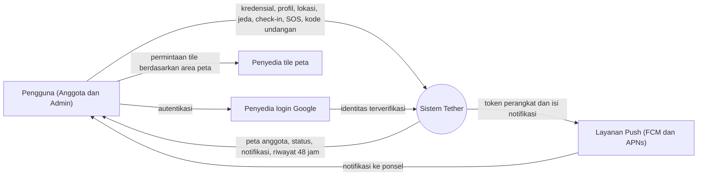
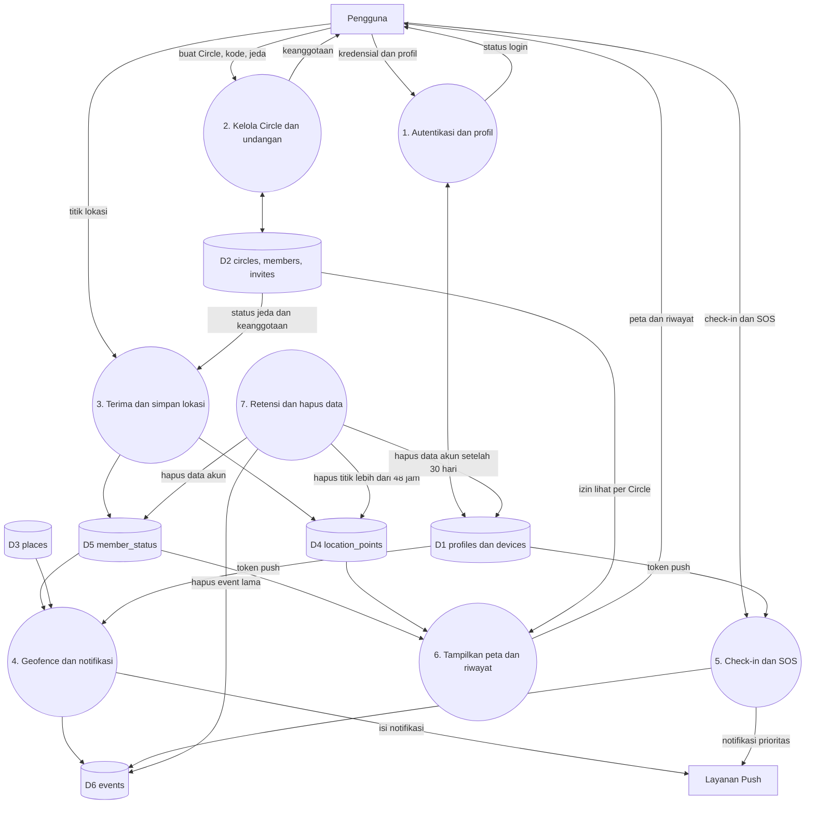

# 05. Privasi, Keamanan, dan Kepatuhan

Versi: Draf 2 (bagian 5, 6, 7, dan 10 diselaraskan dengan migrasi `20261104120000` sampai `20261104130800` per 2026-11-05). **Ini bukan nasihat hukum.** Tinjau dengan konsultan hukum sebelum rilis publik. Kutipan aturan dan kebijakan store perlu diverifikasi ke versi terbaru **[Belum diverifikasi]**.

Ruang lingkup verifikasi: klaim tentang database (RLS, retensi, hapus akun) diperiksa dengan membaca migrasi dan lulus 634 tes pgTAP di Supabase lokal. Klaim tentang Android, ponsel, notifikasi push (FCM), layanan background, dan pembaca layar (TalkBack) **belum terverifikasi**.

## 1. Prinsip
1. Consent eksplisit dan dapat ditarik kapan saja.
2. Transparansi: pengguna selalu tahu siapa yang bisa melihat lokasinya.
3. Minimalisasi data dan retensi pendek.
4. Tidak ada penjualan atau pembagian data lokasi ke pihak ketiga.
5. Tidak ada mode pelacakan tersembunyi.

## 2. Hukum Indonesia
- **UU No. 27 Tahun 2022 tentang Pelindungan Data Pribadi (UU PDP)**: data lokasi termasuk data pribadi. Perlu dasar pemrosesan (persetujuan), hak subjek data (akses, koreksi, hapus, tarik persetujuan), pemberitahuan insiden, dan kebijakan privasi berbahasa Indonesia.
- Perlu dipastikan: apakah data spesifik anak memerlukan persetujuan orang tua atau wali dan batas usianya.
- Lokasi server Supabase di luar negeri: periksa aturan transfer data lintas negara.

## 3. Pengguna anak
- Keputusan MVP (usulan): usia minimum 13 tahun untuk membuat akun sendiri. Anak di bawah itu tidak didukung di MVP.
- Anggota remaja tetap punya tombol jeda dan tahu bahwa lokasinya dibagikan.
- Dokumentasikan keputusan ini di kebijakan privasi dan tinjau secara hukum.

## 4. Persyaratan store
**Google Play** **[V]**
- Izin lokasi background perlu formulir deklarasi, video demo, dan pengungkapan yang menonjol (prominent disclosure) di dalam aplikasi sebelum meminta izin.
- Fitur inti aplikasi harus bergantung pada lokasi background, dan harus dijelaskan.
- Formulir keamanan data (Data safety) harus akurat.

**Apple App Store** **[V]**
- Teks alasan izin lokasi "Always" yang jelas di Info.plist.
- Penjelasan di App Review tentang kebutuhan lokasi background.
- Keterangan privasi aplikasi (App Privacy details) yang akurat.

**Tindakan:** baca ulang kebijakan resmi saat fase persiapan rilis, jangan mengandalkan catatan ini.

## 5. Model ancaman
| Ancaman | Contoh | Mitigasi |
|---------|--------|----------|
| Penguntitan | Pelaku memaksa korban memasang aplikasi | Notifikasi persisten "Tether aktif", tombol jeda, panduan keselamatan, kemampuan keluar Circle tanpa sepengetahuan anggota lain bila aman (dipertimbangkan). Catatan: keluar Circle menerbitkan event `member_left` yang terlihat anggota lain, jadi "tanpa sepengetahuan" belum terpenuhi. Notifikasi persisten Android belum terverifikasi |
| Tebakan kode undangan | Orang asing masuk Circle | Kode 6 karakter dari 31 simbol (sekitar 887 juta kombinasi) dari CSPRNG, hanya hash disimpan, kedaluwarsa 48 jam, maksimal 10 pemakaian, 10 percobaan gagal per 15 menit per pengguna (`TH002`), maksimal 10 anggota per Circle. Persetujuan admin atas anggota baru TIDAK ada. Batas per pengguna dapat dilewati dengan banyak akun (pendaftaran anonim aktif di config lokal) |
| Pengambilalihan akun | Phishing atau pencurian sesi | Verifikasi email, penguncian percobaan berulang, tanda tangan sesi aman |
| Kebocoran data lewat RLS salah | Anggota Circle lain membaca lokasi | Tes RLS otomatis (pgTAP), review kebijakan, hak tulis klien dicabut kecuali lewat RPC, admin tidak punya akses khusus ke lokasi anggota yang dijeda |
| Kebocoran lewat Realtime | Event DELETE tidak difilter RLS dan membawa primary key | `circle_members` dikeluarkan dari publikasi (ADR-016). Sisa pada DELETE `member_status`, `events`, dan `places` (migrasi `131000`) hanya kunci utama; risikonya diterima dan didokumentasikan (ADR-016/ADR-018, sprint-1-5.md) |
| Penyalahgunaan SOS | Memicu SOS palsu berulang | Tahan 3 detik, hitung mundur 5 detik bisa dibatalkan, batas 3 per 10 menit (`TH007`), `client_id` idempoten |
| Akun terhapus masih aktif | JWT lama dipakai setelah hapus akun | Login diblokir dan sesi dicabut; JWT yang sudah terbit tetap sah sampai kedaluwarsa (1 jam di config lokal). RPC tulis kini menolak akun terhapus lewat `assert_account_active()` (migrasi `130900`, ADR-017); sisa risiko hanya baca |
| Kebocoran kunci | Kunci service role di klien | Kunci hanya di server, hanya kunci anon di klien |
| Pemalsuan lokasi | Mock location | Deteksi dasar (flag mock), tidak menjadi jaminan. Server memeriksa rentang, bukan keaslian titik. SOS menerima koordinat apa pun yang valid dari klien |
| Log berisi lokasi | Debugging tidak sengaja | Larangan log koordinat, tinjauan kode |

## 5a. Diagram aliran data (DFD)

### Level 0 (konteks)

Catatan privasi: permintaan tile peta dikirim dari ponsel ke penyedia tile, sehingga penyedia bisa mengetahui area yang dilihat. Pertimbangkan saat memilih penyedia (ADR-004).

### Level 1

Pemetaan ke prinsip privasi: data lokasi hanya mengalir ke D4 dan D5, dibaca lewat P6 dengan filter keanggotaan dan jeda, dan dihapus oleh P7. Tidak ada aliran data lokasi ke pihak ketiga selain notifikasi yang memuat lokasi SOS.

Catatan implementasi: koordinat juga ada di payload event SOS (D6), satu-satunya event berkoordinat (ADR-012), terbaca anggota Circle selama 48 jam. `push_outbox` tidak menyimpan isi, hanya `event_id` dan penerima; pengirim ke Push (FCM) belum dibangun, sehingga aliran "isi notifikasi" ke layanan push belum ada. P3 menegakkan jeda: titik pengguna yang semua keanggotaannya dijeda tidak disimpan.

## 6. Kontrol keamanan teknis
- TLS di semua koneksi, enkripsi diam pada penyimpanan Supabase.
- Penyimpanan token di Keychain dan Keystore **[Belum diverifikasi: belum dikerjakan atau diuji di Android]**.
- Token push di `devices` tidak dapat dibaca klien (tanpa SELECT), hanya didaftarkan atau dicabut lewat RPC.
- RLS aktif pada semua tabel `public`, tanpa pengecualian (diperiksa tes pgTAP). Hak dasar `anon` dan `authenticated` dicabut, lalu hanya yang perlu diberikan.
- Semua tulis lewat RPC `SECURITY DEFINER` dengan `search_path` terkunci, `EXECUTE` dicabut dari `public` dan `anon`, pengguna dari `auth.uid()`. Tidak ada Edge Function (ADR-009). Validasi masukan dan batas laju dilakukan di RPC (kode `TH001` sampai `TH008`, lihat 03).
- Pesan galat dan log tidak memuat koordinat. Klien tidak mencatat koordinat ke log.
- Kunci service role tidak ada di klien. Klien hanya memegang kunci anon.
- Dependensi dipantau kerentanannya. Jalankan analisis keamanan sebelum rilis.
- Pencadangan database dan uji pemulihan **[Belum dikerjakan]**.
- Konfigurasi auth lokal saat ini: pendaftaran anonim aktif (`enable_anonymous_sign_ins = true`) dan konfirmasi email mati (`enable_confirmations = false`). Itu nyaman untuk uji, tetapi **jangan** `supabase config push` atau `db push` ke proyek cloud sebelum keduanya ditinjau dan, bila perlu, diubah.

## 7. Hak pengguna dan retensi

Tabel di bawah menggambarkan perilaku SERVER yang sudah diimplementasikan dan diuji (lihat 04 untuk mekanisme).

| Data | Retensi | Catatan |
|------|---------|---------|
| Titik lokasi (`location_points`) | 48 jam | Dibuang `purge_old_location_points()` tiap jam. Server juga menolak titik lebih tua dari 48 jam. Anggota lain hanya bisa membaca titik 48 jam terakhir selama berbagi aktif |
| Posisi terakhir (`member_status`) | Selama akun ada | Berhenti diperbarui bila berbagi dijeda atau dimatikan di semua Circle. Dihapus saat hapus akun. TIDAK dihapus oleh "hapus riwayat". Rancangan awal "hapus saat keluar Circle" **tidak diimplementasikan**: keluar Circle menghapus status geofence, bukan `member_status` |
| Events (`events`) | 90 hari | `purge_old_events()` harian 03:10 UTC |
| Koordinat SOS | 48 jam | Setelah 48 jam hanya pelaku yang bisa membaca event SOS (RLS); `purge_old_events()` membuang `lat`, `lng`, `accuracy_m` dari payload. Karena cron harian, data fisik bisa bertahan sampai sekitar 72 jam |
| Check-in | 90 hari | Tanpa koordinat |
| Status geofence (`member_place_state`) | Selama keanggotaan | Dihapus saat keluar atau dikeluarkan dari Circle |
| Token perangkat (`devices`) | Sampai dicabut atau akun dihapus | Maksimal 10 per pengguna |
| Antrean push (`push_outbox`) | Cascade dari `events` (90 hari) | Belum ada pengirim. Tidak memuat isi payload |
| Antrean lokal di ponsel (titik lokasi, SOS) | Sampai terkirim | SOS lebih tua dari 1 hari dibuang. Berkas antrean SOS memuat koordinat di perangkat |
| Akun | Nonaktif segera, tuntas dalam 30 hari | Lihat bagian 7a |

Pengguna dapat: melihat riwayat lokasi 48 jam sendiri, menjeda (per Circle), keluar Circle, menghapus riwayat lokasi (`delete_my_location_history()`), menghapus akun (`delete_account()`).

Hak "mengakses data" dan "mengoreksi" sebatas profil dan riwayat 48 jam yang tampil di aplikasi; ekspor data lengkap **belum ada**. Dampak untuk UU PDP perlu ditinjau hukum.

### 7a. Hapus akun
1. Segera: akun ditandai `deleted_at`, login diblokir, sesi dicabut, keluar dari semua Circle (promosi admin atau penghapusan Circle bila anggota terakhir), titik lokasi, event, perangkat, posisi terakhir, status geofence, dan antrean push dihapus. Aplikasi meminta konfirmasi ganda (ketik `HAPUS`).
2. Setelah 30 hari: `purge_deleted_accounts()` menghapus `auth.users` dan semua data turunan lewat cascade, serta Circle tanpa anggota.
3. Keterbatasan yang diketahui:
   - Access token (JWT) yang sudah terbit tetap sah sampai kedaluwarsa (`jwt_expiry` 3600 detik di config lokal). Selama itu akun yang baru dihapus masih bisa memanggil RPC, tetapi semua RPC tulis kini menolaknya lewat `assert_account_active()` (migrasi `130900`, ADR-017); sisa risikonya hanya baca. Perilaku pelacakan di klien setelah sesi dicabut belum diverifikasi.
   - `purge_deleted_accounts()` kini berjalan tiap jam (menit 17), jadi penghapusan tuntas tidak lagi terlambat satu hari melewati hari ke-30.
   - Penghapusan bergantung pada `pg_cron` (ADR-013). Bila ekstensi ada tetapi job gagal terdaftar, migrasi kini GAGAL dengan pesan eksplisit. Kegagalan eksekusi harian tetap wajib dicek setelah deploy.
   - Event milik pengguna dihapus saat hapus akun, termasuk SOS lama. Event `member_left` baru tetap terbit agar anggota lain tahu.

## 8. Dokumen yang harus ada sebelum rilis
- [ ] Kebijakan Privasi (Indonesia dan English)
- [ ] Syarat dan Ketentuan
- [ ] Teks pengungkapan izin lokasi dalam aplikasi
- [ ] Halaman keamanan untuk korban penguntitan
- [ ] Prosedur penanganan insiden kebocoran data
- [ ] Prosedur permintaan hapus data

## 8a. Belum terverifikasi (Android, ponsel, push)
- Prominent disclosure, izin lokasi background, notifikasi persisten, dan perilaku penghematan baterai di Android: belum dibangun di ponsel dan belum diuji (Sprint 0B).
- Notifikasi push (FCM) dan prioritas tinggi untuk SOS: belum ada pengirim; hanya notifikasi lokal saat aplikasi terbuka (ADR-011).
- Aksesibilitas dengan TalkBack, termasuk jalur SOS aksesibel: belum diuji.
- Penyimpanan token di Keystore: belum dikerjakan.
- Tinjauan hukum atas kebijakan privasi, syarat layanan, persetujuan, dan usia minimum: belum ada.

## 9. Pertanyaan terbuka
- Usia minimum final.
- Kebijakan admin terhadap anggota yang menjeda. Saat ini admin melihat status "menjeda" tetapi tidak bisa membaca lokasi.
- Apakah SOS yang tetap berlaku saat dijeda dan membawa koordinat perlu disebut eksplisit di persetujuan dan kebijakan privasi (ADR-012)?
- Retensi 90 hari untuk `events` dan koordinat SOS 48 jam: angka usulan, perlu keputusan akhir dan tinjauan hukum.
- Pendaftaran anonim dan konfirmasi email di proyek cloud: matikan atau pertahankan?
- Perlu pendaftaran penyelenggara sistem elektronik (PSE) di Kominfo/Komdigi? **[V]**
