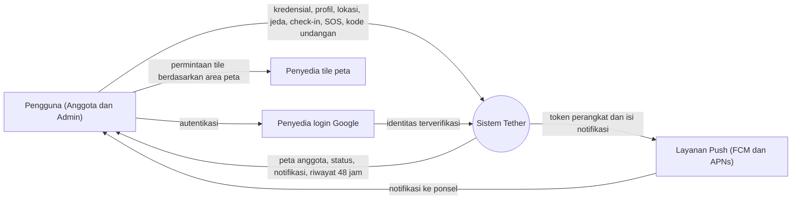
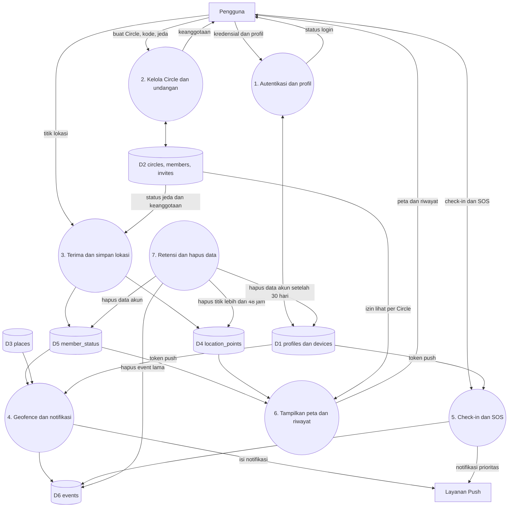

# 05. Privasi, Keamanan, dan Kepatuhan

Versi: Draf 1. **Ini bukan nasihat hukum.** Tinjau dengan konsultan hukum sebelum rilis publik. Kutipan aturan dan kebijakan store perlu diverifikasi ke versi terbaru **[Belum diverifikasi]**.

## 1. Prinsip
1. Consent eksplisit dan dapat ditarik kapan saja.
2. Transparansi: pengguna selalu tahu siapa yang bisa melihat lokasinya.
3. Minimalisasi data dan retensi pendek.
4. Tidak ada penjualan atau pembagian data lokasi ke pihak ketiga.
5. Tidak ada mode pelacakan tersembunyi.

## 2. Hukum Indonesia
- **UU No. 27 Tahun 2022 tentang Pelindungan Data Pribadi (UU PDP)**: data lokasi termasuk data pribadi. Perlu dasar pemrosesan (persetujuan), hak subjek data (akses, koreksi, hapus, tarik persetujuan), pemberitahuan insiden, dan kebijakan privasi berbahasa Indonesia.
- Perlu dipastikan: apakah data spesifik anak memerlukan persetujuan orang tua atau wali dan batas usianya.
- Lokasi server Supabase di luar negeri: periksa aturan transfer data lintas negara.

## 3. Pengguna anak
- Keputusan MVP (usulan): usia minimum 13 tahun untuk membuat akun sendiri. Anak di bawah itu tidak didukung di MVP.
- Anggota remaja tetap punya tombol jeda dan tahu bahwa lokasinya dibagikan.
- Dokumentasikan keputusan ini di kebijakan privasi dan tinjau secara hukum.

## 4. Persyaratan store
**Google Play** **[V]**
- Izin lokasi background perlu formulir deklarasi, video demo, dan pengungkapan yang menonjol (prominent disclosure) di dalam aplikasi sebelum meminta izin.
- Fitur inti aplikasi harus bergantung pada lokasi background, dan harus dijelaskan.
- Formulir keamanan data (Data safety) harus akurat.

**Apple App Store** **[V]**
- Teks alasan izin lokasi "Always" yang jelas di Info.plist.
- Penjelasan di App Review tentang kebutuhan lokasi background.
- Keterangan privasi aplikasi (App Privacy details) yang akurat.

**Tindakan:** baca ulang kebijakan resmi saat fase persiapan rilis, jangan mengandalkan catatan ini.

## 5. Model ancaman
| Ancaman | Contoh | Mitigasi |
|---------|--------|----------|
| Penguntitan | Pelaku memaksa korban memasang aplikasi | Notifikasi persisten "Tether aktif", tombol jeda, panduan keselamatan, kemampuan keluar Circle tanpa sepengetahuan anggota lain bila aman (dipertimbangkan) |
| Tebakan kode undangan | Orang asing masuk Circle | Kode panjang acak, kedaluwarsa, batas pemakaian, persetujuan admin |
| Pengambilalihan akun | Phishing atau pencurian sesi | Verifikasi email, penguncian percobaan berulang, tanda tangan sesi aman |
| Kebocoran data lewat RLS salah | Anggota Circle lain membaca lokasi | Tes RLS otomatis, review kebijakan |
| Kebocoran kunci | Kunci service role di klien | Kunci hanya di server, hanya kunci anon di klien |
| Pemalsuan lokasi | Mock location | Deteksi dasar (flag mock), tidak menjadi jaminan |
| Log berisi lokasi | Debugging tidak sengaja | Larangan log koordinat, tinjauan kode |

## 5a. Diagram aliran data (DFD)

### Level 0 (konteks)

Catatan privasi: permintaan tile peta dikirim dari ponsel ke penyedia tile, sehingga penyedia bisa mengetahui area yang dilihat. Pertimbangkan saat memilih penyedia (ADR-004).

### Level 1

Pemetaan ke prinsip privasi: data lokasi hanya mengalir ke D4 dan D5, dibaca lewat P6 dengan filter keanggotaan dan jeda, dan dihapus oleh P7. Tidak ada aliran data lokasi ke pihak ketiga selain notifikasi yang memuat lokasi SOS.

## 6. Kontrol keamanan teknis
- TLS di semua koneksi, enkripsi diam pada penyimpanan Supabase.
- Penyimpanan token di Keychain dan Keystore.
- RLS aktif pada semua tabel, tanpa pengecualian.
- Edge Function memvalidasi masukan dan membatasi laju (rate limit).
- Dependensi dipantau kerentanannya. Jalankan analisis keamanan sebelum rilis.
- Pencadangan database dan uji pemulihan.

## 7. Hak pengguna dan retensi
| Data | Retensi |
|------|---------|
| Titik lokasi | 48 jam |
| Posisi terakhir | Selama berbagi aktif, hapus saat keluar Circle |
| Events | 90 hari (usulan) |
| Akun | Sampai dihapus. Penghapusan tuntas dalam 30 hari |

Pengguna dapat: melihat data sendiri, menjeda, keluar Circle, menghapus riwayat, menghapus akun.

## 8. Dokumen yang harus ada sebelum rilis
- [ ] Kebijakan Privasi (Indonesia dan English)
- [ ] Syarat dan Ketentuan
- [ ] Teks pengungkapan izin lokasi dalam aplikasi
- [ ] Halaman keamanan untuk korban penguntitan
- [ ] Prosedur penanganan insiden kebocoran data
- [ ] Prosedur permintaan hapus data

## 9. Pertanyaan terbuka
- Usia minimum final.
- Kebijakan admin terhadap anggota yang menjeda.
- Perlu pendaftaran penyelenggara sistem elektronik (PSE) di Kominfo/Komdigi? **[V]**
