# 07. Diagram Analisis dan Perancangan (OOAD)

Semua diagram memakai Mermaid dan tampil otomatis di GitHub. Diagram komponen dan deployment ada di [03-architecture.md](03-architecture.md), DFD ada di [05-privacy-security.md](05-privacy-security.md), ERD ada di [04-data-model.md](04-data-model.md).

Catatan: Mermaid tidak punya tipe use case dan activity diagram bawaan, jadi keduanya digambar dengan `flowchart` memakai notasi yang mendekati UML. Nama kelas dan kode memakai bahasa Inggris, label alur memakai bahasa Indonesia.

Daftar isi:
1. Use case
2. Activity diagram (onboarding izin, gabung Circle, jeda berbagi, SOS)
3. Sequence diagram (unggah lokasi, tiba di tempat, SOS, hapus akun)
4. Class diagram (domain, lapisan aplikasi)
5. State machine (status anggota, SOS, undangan)

---

## 1. Use case

Aktor: **Anggota**, **Admin** (Admin adalah Anggota dengan hak tambahan), dan **Sistem Push (FCM)** sebagai aktor sekunder.

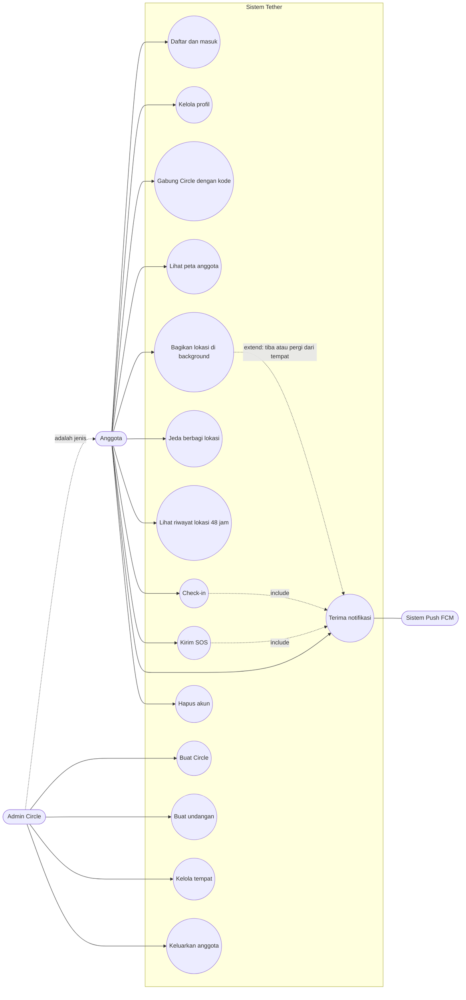

Ringkasan hubungan:
- Check-in dan SOS selalu memicu notifikasi (`include`).
- Notifikasi tiba atau pergi hanya muncul jika lokasi dibagikan dan ada tempat yang cocok (`extend`).
- Jeda berbagi membatasi use case "Bagikan lokasi di background".

---

## 2. Activity diagram

### 2.1 Onboarding dan izin (F13)

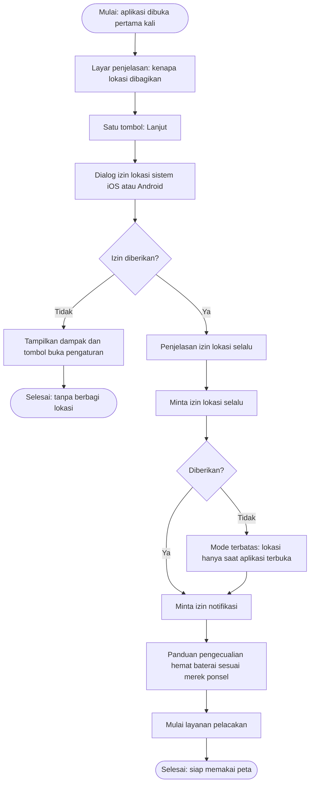

### 2.2 Gabung Circle dengan kode (F3)

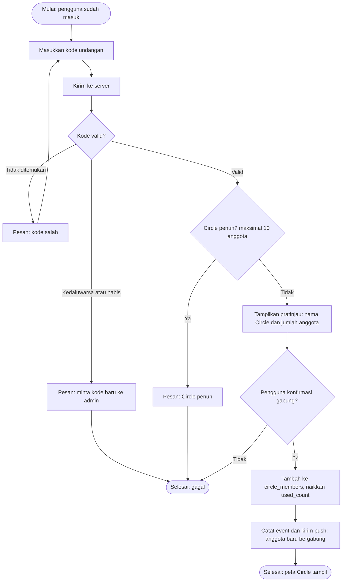

### 2.3 Jeda berbagi lokasi (F6)

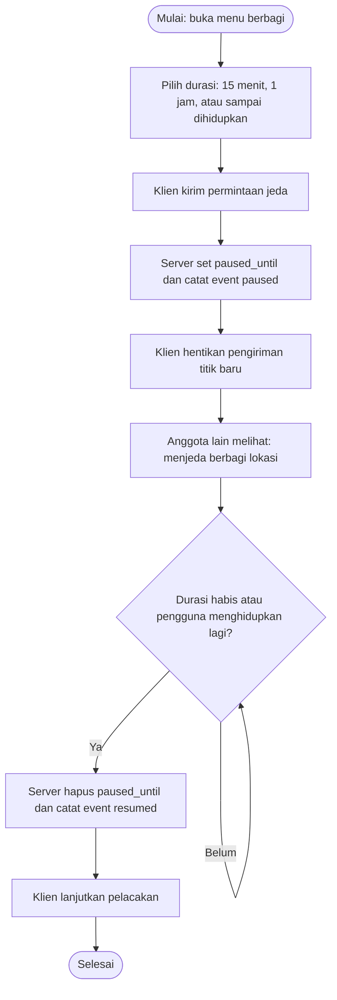

### 2.4 Kirim SOS (F9)

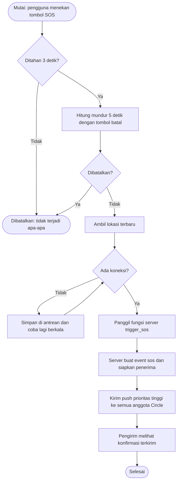

---

## 3. Sequence diagram

### 3.1 Unggah lokasi di background (F5)

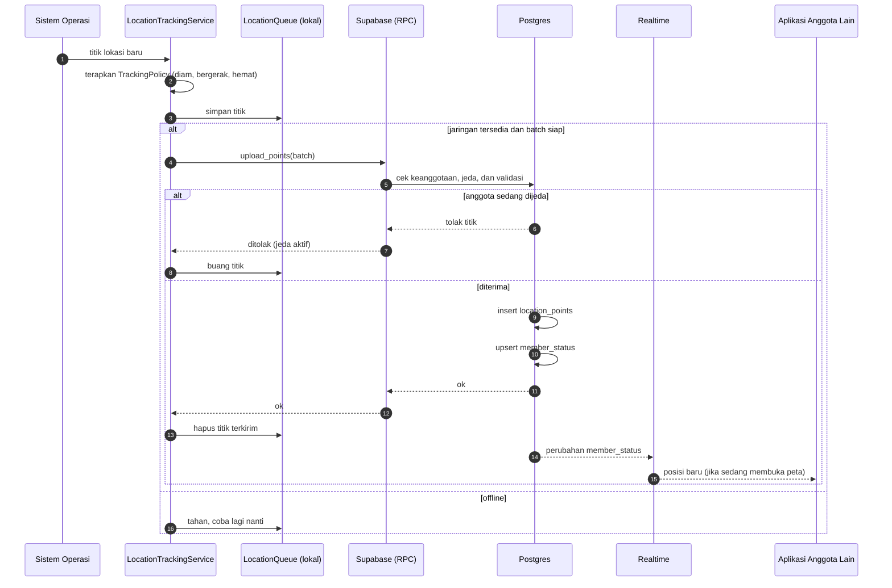

### 3.2 Tiba atau pergi dari tempat (F7)

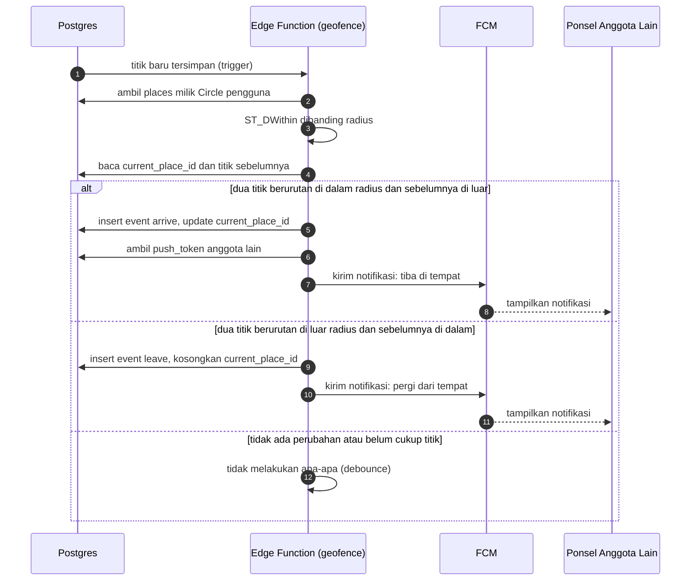

### 3.3 SOS (F9)

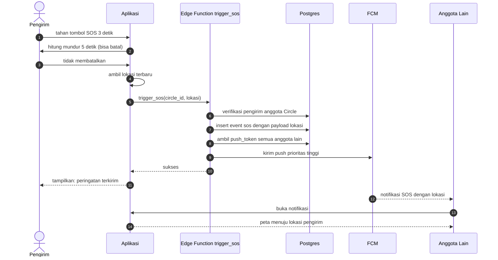

### 3.4 Hapus akun (F12)

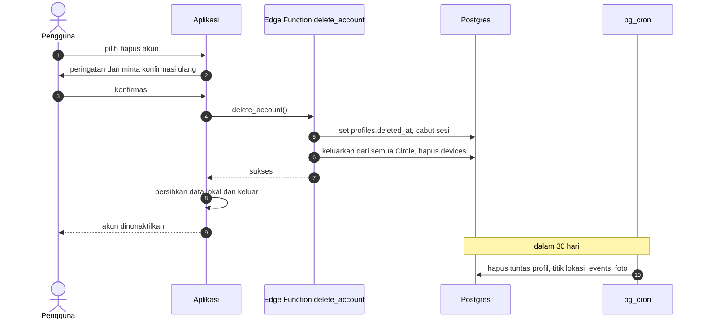

---

## 4. Class diagram

### 4.1 Model domain

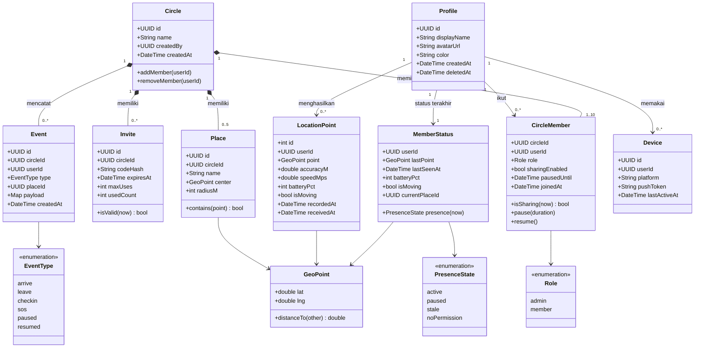

### 4.2 Lapisan aplikasi Flutter (usulan)

Mengikuti struktur `features/` pada [03-architecture.md](03-architecture.md). Nama kelas bersifat usulan.

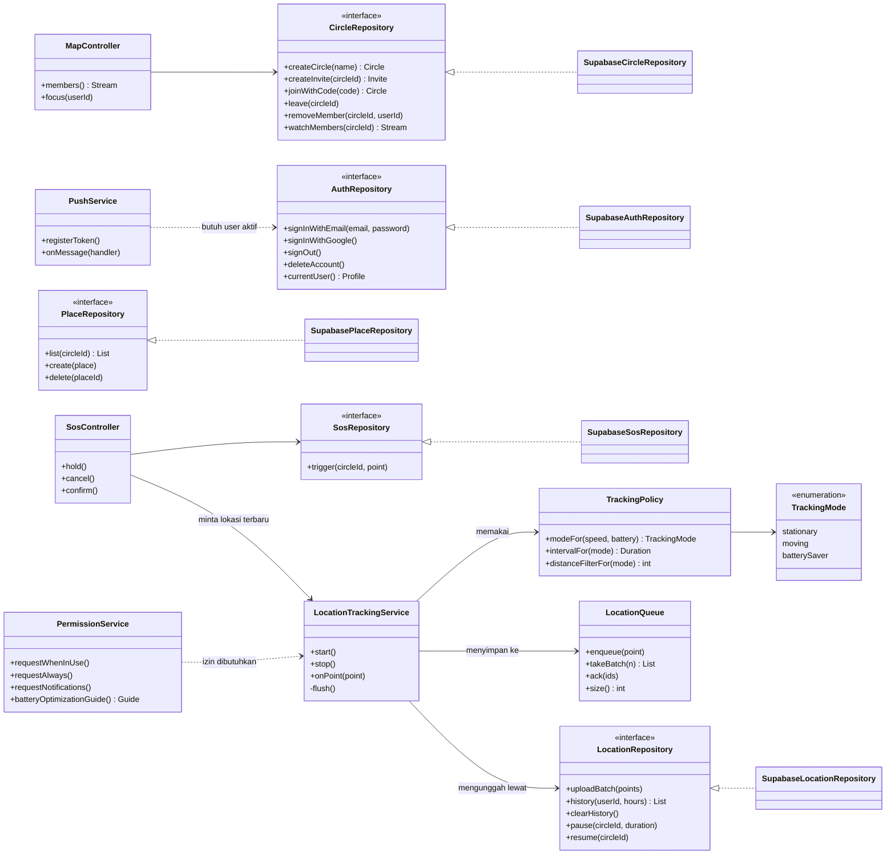

Prinsip: antarmuka repository dipisah dari implementasi Supabase agar mudah diuji dengan tiruan (mock) dan agar backend bisa diganti tanpa mengubah UI.

---

## 5. State machine

### 5.1 Status anggota di peta

Dihitung dari `member_status`, `circle_members`, dan izin. Batas waktu "basi" masih usulan dan perlu dikalibrasi di spike (06).

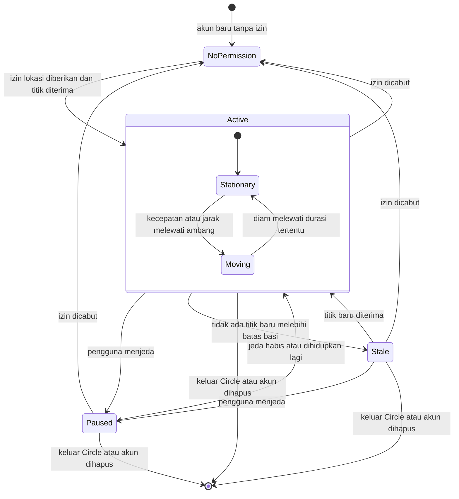

Tampilan pada peta:
- `Active`: marker normal dengan waktu pembaruan.
- `Paused`: marker abu-abu dengan teks "menjeda berbagi lokasi".
- `Stale`: marker pudar dengan teks "terakhir terlihat X lalu".
- `NoPermission`: tanpa marker, teks "izin lokasi belum aktif".

### 5.2 Siklus SOS

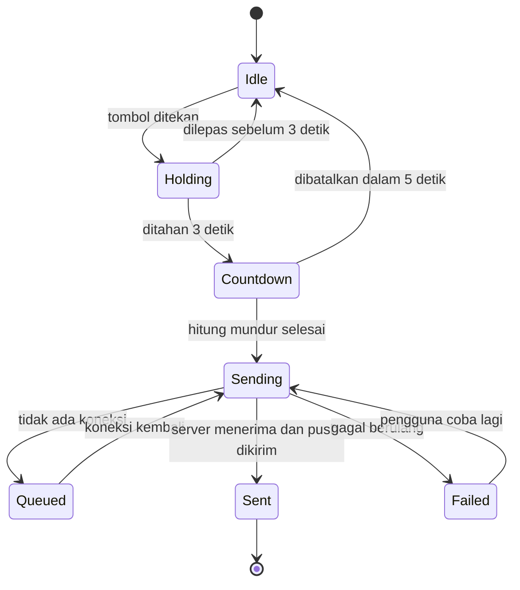

### 5.3 Siklus undangan

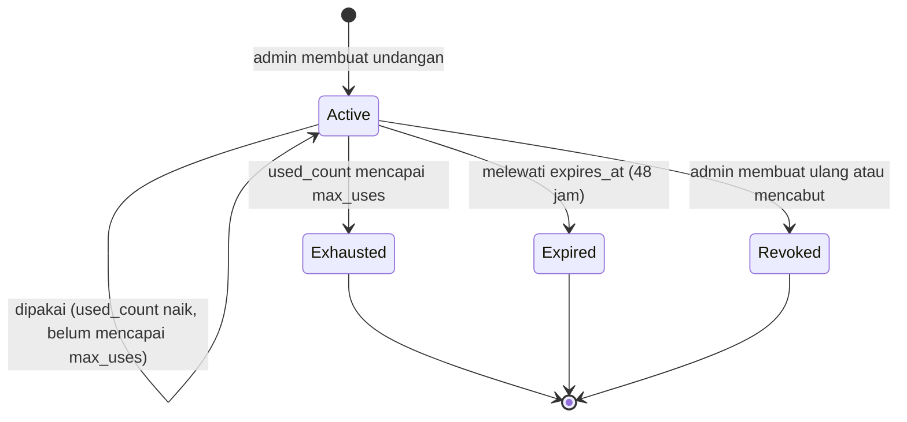

---

## Cara memperbarui
- Ubah diagram bersamaan dengan perubahan PRD, model data, atau ADR terkait.
- Cek tampilan di pratinjau Markdown GitHub atau editor [mermaid.live](https://mermaid.live) sebelum commit.
