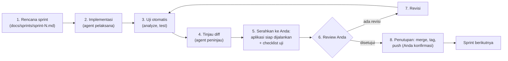
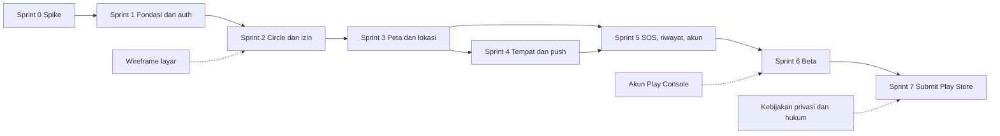

# 09. Sprint Plan: Tether MVP (Android dulu)

Versi: Draf 2 | Direvisi: 2026-11-04 (menyesuaikan jawaban pemilik produk)

Dokumen ini memecah roadmap di [06](06-roadmap.md) menjadi sprint yang dikerjakan satu per satu. ID fitur (F1 sampai F13) merujuk ke [01-prd.md](01-prd.md).

## 1. Keputusan dan batasan yang berlaku

| Hal | Keputusan |
|-----|-----------|
| Siapa yang mengimplementasi | **Claude** (lewat agent pelaksana, penguji, peninjau sesuai aturan kerja). |
| Peran pemilik produk | Review hasil tiap sprint, uji di ponsel, buat akun (Google Play), putuskan hal yang terbuka, setujui commit dan push. |
| Platform rilis pertama | **Android saja**, dipublikasi ke **Google Play** lebih dulu. |
| iOS | **Ditunda.** Tidak ada Mac dan iPhone. Lihat bagian 2. |
| Lingkungan uji | **Komputer Linux ini**: aplikasi desktop Linux, Chrome, dan emulator Android yang sudah terpasang. Ponsel Redmi hanya dipakai untuk uji lokasi background (Sprint 0B), ditunda sampai diperlukan. Tidak ada Samsung, Oppo, Vivo, atau iPhone. |
| Desain | Satu desain gaya Apple ([08](08-design-system.md)), dijalankan di Android memakai widget bergaya Cupertino. Liquid Glass hanya berupa fallback (blur tipis atau permukaan solid) karena tidak ada di Android. |
| Backend | Supabase. Monetisasi: gratis dulu. |
| Ritme kerja | Satu siklus per sprint: **kerjakan, review, revisi, lanjut ke sprint berikutnya**. Tidak ada tanggal kalender. Lama tiap sprint bergantung pada kecepatan review dan pengujian di ponsel. |

Catatan tafsir: saya mengartikan "kerjain setelah sprint 1, review, revisi, next sprint" sebagai siklus di atas, berlaku untuk setiap sprint termasuk Sprint 0 dan 1. Bila maksud Anda berbeda, kabari saya.

## 2. Dampak tidak adanya Mac dan iPhone
- Build dan uji iOS memerlukan macOS dan Xcode **[Belum diverifikasi untuk alur tanpa Mac]**. Tanpa iPhone, perilaku lokasi background iOS tidak bisa diuji sama sekali.
- Karena itu **semua klaim "berfungsi" di dokumen ini hanya berlaku untuk Android**. Kode iOS yang mungkin ikut tertulis tidak dianggap terverifikasi.
- Yang tidak dikerjakan sekarang: izin dan Info.plist iOS, APNs, TestFlight, akun Apple Developer, label privasi App Store, tinjauan App Store.
- Folder `ios/` di proyek dibiarkan apa adanya supaya tidak perlu dibuat ulang nanti.
- Fase iOS (di luar rencana ini) membutuhkan: akses ke Mac (milik sendiri, Mac cloud, atau CI macOS), iPhone untuk uji, dan akun Apple Developer berbayar. Tanggung jawab dan biaya diputuskan saat itu.

## 3. Pengujian di komputer Linux ini

Hasil pengecekan lingkungan (2026-11-04):
- Target aplikasi desktop Linux bisa dibangun (cmake, ninja, clang ada). Folder `linux/` belum ada di proyek, dibuat di Sprint 0 dengan `flutter create --platforms=linux .`.
- Dua emulator Android terpasang: Medium Phone API 36.1 dan Pixel 9 Pro. `/dev/kvm` ada, tetapi hak akses akun Anda belum diverifikasi.
- Docker 29.7.2 terpasang, Supabase CLI belum.
- RAM 15 GB dengan sekitar 5 GB tersedia saat dicek. Emulator, Supabase lokal, dan aplikasi desktop sekaligus bisa terasa sempit.

### Apa yang bisa dan tidak bisa dibuktikan di Linux

| Hal yang diuji | Linux desktop | Emulator Android | Chrome (web) | Ponsel Redmi |
|----------------|---------------|------------------|--------------|--------------|
| UI, tema gelap dan terang, ukuran teks | Ya | Ya | Ya | Ya |
| Autentikasi, Circle, RLS, realtime | Ya | Ya | Ya | Ya |
| Beberapa klien sekaligus (uji Circle) | Ya, gabungkan ketiganya | Ya | Ya | Ya |
| Lokasi simulasi (titik palsu, rute) | Ya | Ya | Ya | Ya |
| GPS nyata | Tidak (hanya perkiraan sistem) | Tidak | Tidak | **Ya** |
| Izin Android, foreground service | Tidak | Ya | Tidak | Ya |
| Notifikasi push FCM | Tidak (belum diverifikasi) | Mungkin, butuh image Google Play (belum dicek) | Tidak | **Ya** |
| Pelacakan bertahan saat aplikasi ditutup atau dimatikan pabrikan | **Tidak** | **Tidak** | **Tidak** | **Ya, hanya di sini** |
| Dampak baterai | **Tidak** | **Tidak** | **Tidak** | **Ya, hanya di sini** |
| Logika geofence di server (SQL, Edge Function) | Ya | Ya | Ya | Ya |

Peringatan jujur: **lulus di Linux atau emulator tidak membuktikan bahwa pelacakan background andal.** Itu risiko terbesar produk ini, dan hanya ponsel yang bisa menjawabnya. Emulator juga tidak meniru perilaku pabrikan seperti Xiaomi atau Redmi yang mematikan aplikasi background.

### Konsekuensi pada rencana
- Sprint 0 dibagi dua: **0A** (Linux dan emulator, sekarang) dan **0B** (ponsel Redmi, ditunda).
- **Gerbang keras:** 0B harus selesai **sebelum Sprint 3 dimulai**. Sprint 1 dan 2 tidak bergantung pada lokasi background, jadi aman dikerjakan lebih dulu. Sprint 3 membangun pelacakan produksi dan butuh bukti dari ponsel untuk memilih pustaka (ADR-005).
- Sesi ponsel 0B dibuat sependek mungkin: sekali aktifkan Debugging USB, lalu saya yang membangun dan memasang aplikasinya, Anda cukup membawa ponsel berjalan dan melaporkan hasil. Perkiraan beban Anda sekitar satu sampai dua jam, belum diuji.
- Kode lokasi dibuat lewat antarmuka `LocationSource` dengan dua implementasi (nyata dan simulasi), sehingga seluruh sisa aplikasi bisa dites di Linux dengan rute palsu.
- Peta: `google_maps_flutter` tampaknya tidak mendukung Linux **[Belum diverifikasi]**, jadi `flutter_map` (OSM) menjadi pilihan alami untuk ADR-004.
- Uji ponsel penuh (baterai 24 jam, merek lain) tetap wajib sebelum beta di Sprint 6.

---

## 4. Prasyarat sebelum Sprint 0 (Anda yang melakukan)
1. Menyetujui lisensi Android SDK: jalankan `flutter doctor --android-licenses` di terminal Anda. Ini persetujuan hukum, jadi saya tidak menjalankannya untuk Anda. Masih dibutuhkan untuk emulator.
2. Pastikan emulator bisa berjalan: akun Anda harus punya akses ke `/dev/kvm` (biasanya lewat grup `kvm`). Saya akan memeriksanya di awal Sprint 0 dan memberi tahu langkahnya bila perlu.
3. **Supabase lokal lewat Docker** (bawaan untuk saat ini, tanpa akun dan tanpa kunci). Saya memakai `npx supabase` tanpa memasang apa pun secara global. Mengunduh image Docker bisa memakan beberapa GB **[Belum diverifikasi]**. Supabase cloud dipakai nanti, saat dibutuhkan (misalnya uji bersama anggota keluarga di luar rumah).
4. Ponsel Redmi **tidak dibutuhkan** sampai Sprint 0B. Saat itu: aktifkan Opsi pengembang dan Debugging USB. Supabase lokal bisa dijangkau ponsel lewat IP komputer bila ada di Wi-Fi yang sama.
5. Akun Google Play Console (biaya pendaftaran sekali bayar, nominal belum diverifikasi): mulai di Sprint 1 karena verifikasi identitas bisa memakan waktu.

---

## 5. Siklus satu sprint

Pembagian tugas pada langkah-langkah:
- **Saya:** rencana sprint, kode, tes, tinjauan diff, build, membuat checklist uji yang spesifik, mencatat hasil.
- **Anda:** menjalankan checklist (di Linux, emulator, dan ponsel bila sudah waktunya), melaporkan temuan, memutuskan hal terbuka, menyetujui sprint.
- Hal yang **tidak bisa saya buktikan sendiri** (perilaku di perangkat nyata, baterai, notifikasi yang benar-benar muncul) ditandai di laporan sebagai "menunggu uji Anda", bukan "selesai".

### Alur git per sprint
- Satu branch per sprint: `sprint/0-spike`, `sprint/1-fondasi`, dan seterusnya.
- Penutupan sprint (setelah Anda menyetujui): merge ke `main`, tag `sprint-N`, **satu push**. Saya selalu bertanya sebelum commit dan push.
- Pesan commit dalam bahasa Indonesia, kalimat pendek, diawali kata kerja ("Tambah", "Perbaiki", "Ubah"). Tanpa watermark Claude.
- Sebelum push: periksa `git status` dan `git diff --cached` untuk `.env*`, `*.jks`, `*.keystore`, `google-services.json`, dan sejenisnya.

### Definition of Done (per tugas)
1. `flutter analyze` tanpa peringatan baru.
2. Tes relevan ada dan lulus (unit, widget, atau tes SQL untuk RLS).
3. Fitur dicoba di lingkungan yang valid untuknya (tabel di bagian 3). Fitur yang hanya bisa dibuktikan di ponsel (lokasi background, baterai, notifikasi nyata) berstatus "menunggu uji ponsel" sampai sesi ponsel dilakukan.
4. Tidak ada koordinat, token, atau kunci di log dan di repo.
5. Teks tampilan berbahasa Indonesia melalui l10n.
6. Dokumen terkait diperbarui bila perilaku berubah.

### Rahasia dan konfigurasi
- Di aplikasi hanya kunci publik (anon) Supabase, lewat `--dart-define` atau berkas konfigurasi yang masuk `.gitignore`.
- Kunci `service_role`, kredensial FCM, dan keystore tidak pernah masuk repo dan tidak pernah dikirim lewat chat.

---

## 6. Ringkasan sprint

| Sprint | Tema | Fitur PRD | Gerbang |
|--------|------|-----------|---------|
| P | Perancangan (selesai) | - | - |
| 0A | Spike alur lokasi di Linux dan emulator | - | - |
| 0B | Uji lokasi background di ponsel Redmi (ditunda, sebelum Sprint 3) | - | **Go atau no-go** |
| 1 | Fondasi dan autentikasi | F1, F2 | - |
| 2 | Circle dan onboarding izin | F3, F13 | - |
| 3 | Peta dan berbagi lokasi | F4, F5, F6 | Uji lapangan baterai |
| 4 | Tempat dan notifikasi push | F7, F10 | - |
| 5 | Check-in, SOS, riwayat, akun | F8, F9, F11, F12 | - |
| 6 | Pengerasan dan beta tertutup | - | Kesiapan rilis |
| 7 | Submit ke Google Play | - | - |

Ukuran tugas (S, M, L) bersifat relatif dan dipakai untuk memotong cakupan sprint bila terlalu besar. Itu bukan perkiraan jam.

---

## 7. Rincian sprint

### Sprint P: Perancangan (selesai)
Hasil: dokumen 00 sampai 09, diagram Mermaid, proyek Flutter kosong.
**Push tertunda:** commit `4970d06` belum di-push. Dokumen 08, 09, dan revisinya belum di-commit. Rekomendasi: satu push penutup dengan tag `sprint-p`.

---

### Sprint 0: Spike pelacakan lokasi (dibagi 0A dan 0B)
**Tujuan:** membuktikan alur data lokasi bekerja ujung ke ujung (0A), dan membuktikan pelacakan background andal di Android (0B).

#### Sprint 0A: Linux dan emulator (dikerjakan sekarang)

| ID | Tugas | Ukuran |
|----|-------|--------|
| T0.1 | Tambah target Linux, jalankan aplikasi di Linux, Chrome, dan emulator | S |
| T0.2 | Supabase lokal lewat Docker: tabel `location_points` minimal dan RLS dasar | M |
| T0.3 | Antarmuka `LocationSource` dengan implementasi simulasi (titik palsu dan rute) | M |
| T0.4 | Pipeline unggah: antrean lokal, batch ke Supabase, uji offline lalu online | L |
| T0.5 | Uji geofence di server (`ST_DWithin`, debounce 2 titik) dengan rute simulasi | M |
| T0.6 | Izin Android dan foreground service bertipe lokasi di emulator **[Belum diverifikasi: syarat tepatnya berbeda antar versi Android]** | M |
| T0.7 | Putuskan ADR-004 (peta), catat di [03](03-architecture.md) | S |

**Checklist uji untuk Anda:** jalankan aplikasi di Linux dan di emulator, mulai rute simulasi, lihat titik muncul di klien lain secara real-time. Putuskan jaringan di tengah rute dan nyalakan lagi: titik tertahan harus terkirim.

**Selesai bila:** unggah ujung ke ujung berjalan di Linux dan emulator dengan rute simulasi, geofence menghasilkan event tiba dan pergi yang benar, dan hasil tercatat di `docs/sprints/sprint-0.md`. Bagian lokasi background dan baterai berstatus **menunggu uji ponsel**.

**Status:** selesai dikerjakan, menunggu review. Hasil dan checklist ada di [sprints/sprint-0.md](sprints/sprint-0.md). T0.6 (izin Android dan foreground service di emulator) belum dikerjakan karena lisensi Android SDK belum disetujui.

**Push:** `sprint/0-spike`, tag `sprint-0a`.

#### Sprint 0B: Ponsel Redmi (ditunda, wajib sebelum Sprint 3)

| ID | Tugas | Ukuran |
|----|-------|--------|
| T0.8 | Build APK dan instal ke Redmi lewat USB | S |
| T0.9 | Layanan lokasi background nyata dengan GPS asli, bandingkan 2 pustaka (ADR-005): lisensi, pemeliharaan, perilaku di Redmi | L |
| T0.10 | Panduan pengaturan hemat baterai Redmi (pengecualian baterai, mulai otomatis) | S |
| T0.11 | Putuskan ADR-005 (pustaka lokasi), catat di [03](03-architecture.md) | S |

**Checklist uji untuk Anda (di Redmi):**
- Titik tetap masuk saat layar terkunci 30 menit.
- Titik tetap masuk setelah aplikasi digeser dari daftar aplikasi terbaru.
- Titik tetap masuk saat berjalan atau berkendara minimal 20 menit.
- Catat persentase baterai awal dan akhir untuk 2 jam diam dan 1 jam bergerak.
- Matikan data seluler lalu nyalakan lagi: titik yang tertahan harus terkirim.

**Selesai bila:** hasil tercatat, Redmi lulus selama 4 jam skenario campuran dengan dampak baterai yang dapat diterima.

**Gerbang go atau no-go:** bila gagal, saya sajikan opsi (kode native, panduan per merek, ubah pendekatan) sebelum Sprint 3. Lulus di Redmi **tidak membuktikan** merek lain, hanya menurunkan risiko.

**Risiko Sprint 0:** pembatasan pabrikan, lisensi pustaka, lisensi SDK belum disetujui, RAM sempit saat menjalankan emulator dan Docker bersamaan.
**Push:** tambahan di branch `sprint/0-spike`, tag `sprint-0b`.

---

### Sprint 1: Fondasi dan autentikasi
**Tujuan:** kerangka aplikasi siap, pengguna bisa daftar dan masuk.

| ID | Tugas | Ukuran |
|----|-------|--------|
| T1.1 | Struktur `features/`, `core/`, `app/` sesuai [03](03-architecture.md), state management (ADR-003) | M |
| T1.2 | Tema dan token dari [08](08-design-system.md): warna dinamis, tipografi, mode terang dan gelap, kontras tinggi. Font Android: Inter (usulan, lisensi dicek) | L |
| T1.3 | Routing dan kerangka tab bar (Peta, Circle, Aktivitas, Profil) | M |
| T1.4 | l10n bahasa Indonesia | S |
| T1.5 | CI: `flutter analyze` dan `flutter test` pada setiap push | M |
| T1.6 | Skema `profiles`, trigger pembuatan profil, migrasi di `supabase/migrations` | M |
| T1.7 | Autentikasi email dan verifikasi email. Google sign-in bila konfigurasinya siap (F1) | L |
| T1.8 | Profil: nama, foto, warna penanda (F2) | M |
| T1.9 | Tes RLS untuk `profiles` | S |
| T1.10 | Akun Google Play Console (Anda), cek aturan uji tertutup untuk akun baru | S |

**Checklist uji untuk Anda:** daftar, verifikasi email, isi profil, keluar, masuk lagi. Ganti tema terang dan gelap. Perbesar ukuran font sistem ke terbesar dan pastikan tata letak tidak rusak.

**Catatan:** Google sign-in butuh konfigurasi di Google Cloud dan sidik jari SHA-1 keystore. Itu langkah yang melibatkan akun Anda dan bisa memperlambat. Bila terlalu lama, Google sign-in digeser ke sprint berikutnya.
**Push:** `sprint/1-fondasi`, tag `sprint-1`.

---

### Sprint 2: Circle dan onboarding izin
**Tujuan:** keluarga bisa membentuk Circle, alur izin sesuai aturan.

| ID | Tugas | Ukuran |
|----|-------|--------|
| T2.1 | Skema `circles`, `circle_members`, `invites` dan RLS | M |
| T2.2 | Buat Circle, kode undangan 6 karakter (hash, kedaluwarsa 48 jam, batas pakai) (F3) | L |
| T2.3 | Gabung dengan kode, pratinjau, batas 10 anggota (F3) | M |
| T2.4 | Daftar anggota, keluar, admin mengeluarkan anggota (F3) | M |
| T2.5 | Tes RLS Circle: pengguna di luar Circle tidak bisa membaca | M |
| T2.6 | Onboarding izin: satu tombol "Lanjut", dialog izin Android, panduan hemat baterai Redmi (F13) | L |
| T2.7 | Pengungkapan menonjol (prominent disclosure) untuk izin lokasi background sesuai Google Play **[Belum diverifikasi, baca kebijakan terbaru]** | M |
| T2.8 | Pra-cek kebijakan Google Play untuk izin lokasi background | S |

**Checklist uji untuk Anda:** dua akun membentuk dan bergabung ke satu Circle dengan kode (butuh dua akun, bisa aplikasi Linux plus emulator). Coba kode salah, kedaluwarsa, dan Circle penuh. Tolak izin lalu lihat perilaku aplikasi.

**Catatan:** uji dua akun memakai aplikasi desktop Linux dan emulator (atau Chrome). Alur izin background hanya bisa dicoba di emulator dan ponsel.
**Push:** `sprint/2-circle`, tag `sprint-2`.

---

### Sprint 3: Peta dan berbagi lokasi
**Tujuan:** inti produk berjalan, anggota saling melihat posisi real-time.

| ID | Tugas | Ukuran |
|----|-------|--------|
| T3.1 | Skema `location_points` (partisi harian), `member_status`, RPC `upload_points`, retensi 48 jam | L |
| T3.2 | Layanan pelacakan versi produksi: antrean, batch, `TrackingPolicy` adaptif (F5) | L |
| T3.3 | Layar Peta penuh layar, marker, tombol melayang (F4) | L |
| T3.4 | Sheet anggota nonmodal (detent medium dan large, grabber) (F4) | M |
| T3.5 | Realtime `member_status` per Circle | M |
| T3.6 | Status kehadiran: aktif, dijeda, basi, tanpa izin | M |
| T3.7 | Jeda berbagi dengan action sheet, ditegakkan di server (F6) | M |
| T3.8 | Tes RLS dan RPC: titik dari anggota yang dijeda ditolak, admin tidak bisa membaca anggota yang dijeda | M |

**Checklist uji untuk Anda:** posisi tampil di peta ponsel lain, tetap diperbarui saat aplikasi ditutup, jeda menghentikan kiriman (cek di tabel Supabase), baterai 24 jam dicatat.

**Gerbang:** Sprint 0B sudah harus lulus sebelum sprint ini dimulai. Uji baterai 24 jam hanya bisa dilakukan di ponsel. Bila baterai atau keandalan tidak memenuhi target PRD (di bawah 5% per hari), perbaiki dulu sebelum menambah fitur.
**Push:** `sprint/3-peta`, tag `sprint-3`.

---

### Sprint 4: Tempat dan notifikasi push
**Tujuan:** pemberitahuan tiba dan pergi dari tempat penting.

| ID | Tugas | Ukuran |
|----|-------|--------|
| T4.1 | Skema `places`, `events`, `devices` dan RLS | M |
| T4.2 | Kelola tempat: radius minimal 100 m, maksimal 5 per Circle (F7) | L |
| T4.3 | Edge Function geofence dengan debounce 2 titik | L |
| T4.4 | Integrasi FCM untuk Android, pendaftaran token (F10) | L |
| T4.5 | Push: tiba, pergi, anggota baru | M |
| T4.6 | Tab Aktivitas: daftar event dan lencana | M |
| T4.7 | Putuskan penyimpanan `google-services.json` | S |

**Prasyarat dari Anda:** proyek Firebase untuk FCM. Kunci rahasia tidak dikirim lewat chat.
**Checklist uji untuk Anda:** tiba di tempat nyata atau simulasi lokasi di emulator, notifikasi muncul di ponsel lain dalam 2 menit tanpa duplikat. Uji dengan aplikasi tertutup dan ponsel terkunci.
**Risiko:** notifikasi di Redmi sering ditahan oleh pengaturan pabrikan **[Belum diverifikasi]**. Hanya bisa dicek di ponsel, jadi bagian ini berstatus "menunggu uji ponsel" sampai sesi ponsel.
**Push:** `sprint/4-tempat-push`, tag `sprint-4`.

---

### Sprint 5: Check-in, SOS, riwayat, akun
**Tujuan:** fitur keselamatan dan kelengkapan akun.

| ID | Tugas | Ukuran |
|----|-------|--------|
| T5.1 | Check-in "Saya sudah sampai" dan "Saya aman" (F8) | M |
| T5.2 | Edge Function `trigger_sos`, push prioritas tinggi dengan lokasi (F9) | L |
| T5.3 | UI SOS: tahan 3 detik, hitung mundur 5 detik bisa dibatalkan, jalur aksesibel untuk TalkBack | L |
| T5.4 | Antrean SOS saat offline dan coba ulang | M |
| T5.5 | Riwayat lokasi 48 jam dan hapus riwayat (F11) | M |
| T5.6 | Pengaturan akun dan hapus akun dengan konfirmasi ganda (F12) | L |
| T5.7 | Job penghapusan tuntas 30 hari | M |
| T5.8 | Keterangan "SOS bukan pengganti layanan darurat" | S |
| T5.9 | Draf kebijakan privasi dan syarat layanan (Anda mengurus tinjauan hukum) | M |

**Checklist uji untuk Anda:** SOS dari satu ponsel diterima di ponsel lain dengan lokasi, bisa dibatalkan, tetap terkirim setelah koneksi kembali. Hapus akun: tidak bisa masuk lagi.
**Push:** `sprint/5-keselamatan`, tag `sprint-5`.

---

### Sprint 6: Pengerasan dan beta tertutup
**Tujuan:** stabil dan siap dinilai pengguna nyata, termasuk merek lain.

| ID | Tugas | Ukuran |
|----|-------|--------|
| T6.1 | Beta tertutup ke keluarga dan teman dengan merek ponsel beragam (jalur uji Play Console) | M |
| T6.2 | Pelaporan crash dan metrik keberhasilan unggah lokasi tanpa menyimpan lokasi di log | M |
| T6.3 | Penyetelan baterai dan keandalan berdasarkan temuan beta | L |
| T6.4 | Audit aksesibilitas: teks terbesar, TalkBack, kontras tinggi, Reduce Motion | L |
| T6.5 | Audit keamanan dan tinjau semua kebijakan RLS | M |
| T6.6 | Pencadangan database dan uji pemulihan | S |
| T6.7 | Materi store: ikon, tangkapan layar, deskripsi, Data safety | M |
| T6.8 | Formulir deklarasi izin lokasi background dan video demo | M |

**Selesai bila:** metrik PRD terpenuhi pada beta (crash-free sessions 99%, lokasi terbaru dalam 15 menit pada 90% anggota berizin) atau selisihnya tercatat dengan rencana perbaikan. Temuan per merek ponsel dicatat.
**Push:** `sprint/6-beta`, tag `sprint-6`.

---

### Sprint 7: Submit ke Google Play
**Tujuan:** rilis pertama di Google Play.

| ID | Tugas | Ukuran |
|----|-------|--------|
| T7.1 | Perbaiki temuan beta yang tersisa | L |
| T7.2 | Buat build rilis ber-tanda-tangan (keystore disimpan Anda, di luar repo) dan App Bundle | M |
| T7.3 | Submit ke Google Play, isi deklarasi dan Data safety | M |
| T7.4 | Tanggapi catatan review | M (tidak pasti) |
| T7.5 | Publikasikan kebijakan privasi dan halaman keamanan | S |
| T7.6 | Rencana pasca-rilis: pemantauan, dukungan, evaluasi metrik, putuskan monetisasi dan fase iOS | M |

**Catatan keystore:** keystore penanda tangan sangat penting. Bila hilang, pembaruan aplikasi bisa terhambat. Anda yang menyimpannya dan mencadangkannya, saya tidak menyimpannya di repo. Detail Play App Signing **[Belum diverifikasi]**.
**Push:** `sprint/7-rilis`, tag `v0.1.0` dan `sprint-7`.

---

## 8. Peta ketergantungan

## 9. Risiko

| Risiko | Dampak | Respons |
|--------|--------|---------|
| Pengembangan awal hanya di Linux dan emulator | Masalah lokasi background dan baterai tidak terlihat sampai ada uji ponsel | Gerbang keras: Sprint 0B sebelum Sprint 3 |
| Hanya satu perangkat uji fisik (Redmi) | Masalah di merek lain tidak terdeteksi sampai beta | Rekrut penguji beta beragam merek, status "basi" dan pelaporan crash |
| Tidak ada iPhone dan Mac | Tidak ada rilis iOS | Android dulu, fase iOS terpisah |
| Pembatasan pabrikan pada Redmi | Inti produk gagal | Sprint 0B sebagai gerbang |
| Kecepatan review dan uji di ponsel menjadi hambatan | Sprint tertunda | Checklist uji dibuat sependek dan sespesifik mungkin, status "menunggu uji Anda" jelas |
| Lisensi pustaka lokasi | Biaya atau perubahan pustaka | Dicek di Sprint 0B |
| RAM terbatas (emulator, Docker, aplikasi sekaligus) | Lambat atau macet | Jalankan seperlunya, tutup yang tidak dipakai |
| Google Play: deklarasi lokasi background atau uji tertutup untuk akun baru | Rilis tertunda | Pra-cek di Sprint 2, mulai uji tertutup lebih awal **[Belum diverifikasi]** |
| Biaya peta atau Supabase | Anggaran | Pantau mulai Sprint 3 |

## 10. Langkah berikutnya
1. Anda menjalankan `flutter doctor --android-licenses`.
2. Anda menyetujui push penutup Sprint P.
3. Saya memulai Sprint 0A: tambah target Linux, Supabase lokal, simulasi lokasi, pipeline unggah.
4. Sprint 0B (ponsel) dijadwalkan bersama sebelum Sprint 3.
